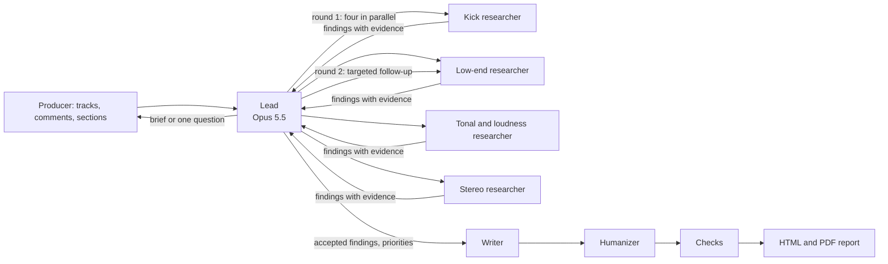

# Fix the Mix

Fix the Mix gives electronic music producers measured, section-aware feedback on a track. You upload your track and one to three reference tracks, say what each reference is for, and check where the intro, builds, drops and breakdowns are. A team of agents then measures the audio and compares it drop to drop and build to build. They return a report: what to change first, what to keep, and the charts behind every claim.

- **Live app:** https://fix-the-mix-347988227457.us-east1.run.app
- **Path:** Deep Research (Project 2). Solo project by Jan Barg (jgb2170).
- **Data:** the producer's own audio. The models have never heard these recordings; every number in a report comes from measuring them (see [Data](#data)).

## Try it

1. Open the live app and click **Or try it with the demo tracks**. This loads my track *Scars* and three references, with comments already filled in.
2. The Lead reads the request and sums up the brief above the section editors. The demo's sections are already checked. Play or zoom them if you like (drag across the overview strip above each waveform), then press **Confirm all**.
3. The analysis takes about 5 minutes. The trace shows four specialist researchers running at the same time, then a targeted follow-up round.
4. Read the report, or download it as a PDF. Then ask follow-up questions in the box under the report: samples 2 and 3 below are good ones to try.

To use your own music, upload WAV or MP3 files of up to 30 MB and between 20 seconds and 10 minutes long. Every run uses real model calls on my API key, about $1.50 for a full report.

## Sample queries

These come from one demo run on the live app on November 7, 2026. [`scripts/sample_queries.py`](scripts/sample_queries.py) asked them exactly as the browser does. Sample 1 is the demo's request; samples 2 and 3 are follow-up questions typed under the report. The run cost $2.26 in all. Here is [its report](https://fix-the-mix-347988227457.us-east1.run.app/api/runs/8ed6485c-454a-40ed-8a3a-41c65eb9a7a3/report) ([PDF](https://fix-the-mix-347988227457.us-east1.run.app/api/runs/8ed6485c-454a-40ed-8a3a-41c65eb9a7a3/report.pdf)), and [the run itself](https://fix-the-mix-347988227457.us-east1.run.app/#run=8ed6485c-454a-40ed-8a3a-41c65eb9a7a3) shows the trace. The raw replies, with every tool call, are in [`demo/samples/agent.json`](demo/samples/agent.json).

**Baselines.** [`scripts/baselines.py`](scripts/baselines.py) sent the same three questions, in one conversation, to the Lead's model (Claude Opus 5.5 through LiteLLM) with no tools and no system prompt. The first message gives what the producer types into the app: which track is which, the titles and the comments. The model gets no audio and no measurements. The Lead runs at high reasoning effort, the baseline at the default. The raw answers are in [`demo/samples/baseline.json`](demo/samples/baseline.json) ($0.11 for all three).

### 1. "Focus on the drops. I want the kick and bass to hit harder without losing the darker tone I have now."

The demo fills this in as the request, with a comment on each track (see [Data](#data)).

**What the agent did:**

- **Brief, 26 s.** The Lead recorded the goals, each reference's job and what to keep. It asked the producer to check one thing: whether the "chorus" at 2:58–3:27 is really a second drop. The script confirmed the sections as they were.
- **Round 1.** The kick, low-end, tonal-and-loudness and stereo researchers started in the same second, and each finished 55–68 s later.
- **Round 2.** The Lead analysed another pair of kicks itself, then sent kick and low-end follow-ups in parallel. They checked whether the weak kick attack held on other kicks, and measured ducking on passages where the bass is steadier.
- **Finishing.** `finish_research` was refused once because an accepted finding quoted a number its evidence did not back. The Lead rejected that finding and finished with 51 findings accepted, 18 rejected and 3 priorities.
- **Report.** Writer, checks, Humanizer, then HTML and PDF. The whole analysis took 336 s.

**Agent's answer** (the summary shown when the analysis finishes; one dash came back as the escape code `\u2013`, shown as a dash here; the app now decodes these):

> The kick isn't quieter than Reference 1's; peak and early level match. The biggest, most consistent difference is below 40 Hz: your drop carries much more deep sub at 28–35 Hz than Reference 1 in both halves of the drop, and your sub barely ducks around the kick while Reference 1's ducks deeply. Taming that region and letting the sub duck for the kick is the top priority. Second, your kick's pitch settles lower (around 38 Hz vs around 43 Hz) in both kicks analysed; nudging it up or shortening the tail could tighten the weight. Third, your build-to-drop jump already matches Reference 2 overall; more impact would come from a slightly lighter build rather than a louder drop. Keep your dark top end, your 56–111 Hz bass balance, the mono low end and the current drop loudness.

The report's priorities:

1. **Clean up the energy below 40 Hz and let the sub duck for the kick.** Your drop has far more energy at 28 and 35 Hz than Reference 1, consistently in both halves of the drop, while 56–111 Hz already matches. Your sub barely ducks around the kick (about 1.6 dB) whereas Reference 1's ducks about 16.5 dB, so each of its hits reads as a separate event. This is the most consistent measured difference behind the kick feeling buried, and fixing it only touches the sub, so the darker tone is safe.
2. **Tune or shorten the kick's low tail so it settles nearer Reference 1's pitch.** In both analysed kicks your kick's pitch settles near 38 Hz, while Reference 1's settles near 43 Hz in both. A deeper settling sweep could feed the sub-40 Hz build-up and overlap the bass fundamental. Retuning slightly higher or shortening the tail may give a tighter, more forward weight like Reference 1, with no top-end change.
3. **Get more build-to-drop contrast by easing the build, not pushing the drop.** Your build-to-drop integrated jump (2.12 LU) already matches Reference 2's (2.03 LU), but Reference 2's short-term lift is larger (2.27 vs 1.33 LU). Your drop is already louder than both Reference 2 drops and your build is dense, so extra impact has to come from a slightly lighter build.

<details>
<summary>The Lead's reply to the request, before the analysis</summary>

> I've got your goals. Here's what I'll look at:
>
> **Goals**
> - Make the kick and bass hit harder in the drops. Right now the kick feels a bit buried under the bass.
> - Keep the darker tone you have now. Nothing I suggest should brighten the track.
>
> **What each reference is for**
> - **Reference 1 (Endless Light):** how heavy the kick and bass are in the drop, and how the kick sits against the bass.
> - **Reference 2 (FE!N remix):** how much louder it gets from the build into the drop.
> - **Reference 3 (Weightless):** stereo width only. I won't treat its brighter top end as a target.
>
> **Assumptions:** this is your mastered version, so I'll compare loudness at master stage. I'll judge each reference only on the job you gave it.
>
> **Please check the sections before I start.** In your track, only 1:47–2:15 is marked as a drop. The section marked "chorus" (2:58–3:27) and the two builds after it (3:27–4:10) could be a second drop and its build-up. If so, please relabel them so I can compare both drops and the jump from each build into its drop. Everything else looks plausible. Let me know if any boundaries need moving, then confirm.

</details>

<details>
<summary>Baseline: same model, no tools, no system prompt (verbatim, headings shown smaller)</summary>

I can't listen to audio, so I can't hear your master or the references. What I can do is give you a way to compare them yourself and the most likely fixes for a kick buried under bass in a dark-toned drop. If you measure the numbers below and share them, I can be more specific.

#### First: fix it before the master if you can

A kick buried under bass in a *mastered* file is usually a mix problem that the limiter made worse. If you have the stems or the session, do the work there. Then re-master, or ask your mastering engineer for less limiting in the drops. Working on the stereo master alone is possible but limited (see the last section).

#### 1. Kick and bass weight (Reference 1: Endless Light)

**How to compare:**
- Loudness-match a 4–8 bar section of your drop against their drop. Use short-term LUFS, not the whole-track integrated value. Without matching, the louder track will always seem better.
- On a spectrum analyzer with slow averaging, compare the 40–60 Hz and 80–120 Hz regions.
- Then solo the low end (low-pass around 150 Hz) and listen to the two tracks back to back. Ask whether the kick rises clearly above the bass, or whether the energy is a constant wall.

**Likely fixes that keep the tone dark:**
- **Give each element its own fundamental.** Decide whether the kick or the bass owns the sub (often roughly 45–60 Hz) and which one owns the punch region (roughly 80–120 Hz). Cut the other element a little in each zone. When both compete in the same band, you get buried kicks.
- **Duck more of the bass, and only in the lows.** Use a dynamic EQ or multiband compressor on the bass, sidechained to the kick, working only below about 150 Hz. Use a fast attack and set the release to match the tempo, so the bass recovers before the next kick. This adds punch without touching the bass's upper harmonics, which is where your dark character lives.
- **Add weight with low-mid saturation, not brightness.** Light saturation on the kick (tape or tube style) with a gentle low-pass afterward keeps it audible on small speakers. Avoid adding click at 3–5 kHz. That's the usual fix for buried kicks, but it would move you away from your tone.
- **Restore the transient.** Use a transient shaper on the kick with more attack. Or put a soft clipper before the limiter, so the limiter isn't squashing every kick hit.

#### 2. Loudness jump from build to drop (Reference 2: FE!N remix)

**How to measure:** Note the short-term LUFS over the last 2–4 bars of the build and the first 2–4 bars of the drop. Do this for both tracks and compare the difference (in LU), not the absolute levels.

**Likely fixes:**
- If your jump is smaller than the reference's, the fix is usually to **make the build quieter**, not the drop louder. Your drop is probably already near the limiter's ceiling.
- **Thin out the build's low end** (high-pass or remove the sub in the last bars). The drop's bass then feels like a bigger arrival even at the same peak level.
- **Keep the limiter working less in the drop.** If it's reducing gain heavily there, the drop's impact gets flattened. A brief drop-out or silence right before the drop also exaggerates the jump.

#### 3. Stereo width (Reference 3: Weightless), ignoring its top end

**How to compare:**
- Use a correlation meter or vectorscope, plus a mid/side solo, on the drop sections.
- Compare how much side energy each track has in the mids (roughly 200 Hz–5 kHz).
- To judge width without the brightness affecting you, low-pass both tracks around 6–8 kHz while comparing. Wider-sounding tracks often just have more top end, and you said you don't want that.

**Likely fixes:**
- Keep everything below about 120–150 Hz mono. This also helps your kick and bass hit harder.
- Get width from the mids: pads, chords, and returns from delays and reverbs. Don't apply a broadband stereo widener on the master.
- Watch that correlation doesn't go near zero or negative in the drop, or the low end will lose punch on mono systems.

#### If you only have the stereo master

- Use mid/side processing to make sure the sides below about 150 Hz are mono.
- Add a small cut to the bass's dominant low frequency. Use a dynamic EQ with a fast release so it mainly reacts to the bass's sustain between kicks.
- Lower the input gain to the final limiter in the drop sections and accept slightly lower loudness in exchange for punch.

These moves help, but they're less effective than separating the kick and bass in the mix.

#### What would help me give specific advice

- Short-term LUFS for the build and the drop, for your track and Reference 2.
- How much gain reduction your limiter shows during the drops.
- Whether you have the stems or session, or only the master.
- The key of the track, or the frequencies where the kick fundamental and the bass's root note sit.

</details>

**The difference.** The baseline says it can't hear the audio and gives a sound general checklist: sidechain the bass below 150 Hz, saturate the kick, add attack, make the build quieter. The agent measured that the kick's level is not the problem (its peak matches Reference 1's). The excess is the sub at 28–35 Hz, and the sub ducks about 1.6 dB around the kick against about 16.5 dB in Reference 1. It also found the kick's attack weaker than the reference's on one pair of kicks and stronger on another, so it did not tell you to add attack.

### 2. "How does my build-to-drop loudness jump compare with Reference 2, and where does mine differ?"

**What the agent did:** one Lead call, 11 s, no new measurements. Round 1 had already measured every section's loudness, so it answered from that evidence.

**Agent's answer:**

> On overall loudness, your jump from build into drop is already about the same as Reference 2's. The difference shows up at the loudest moments, and that's because your build starts higher.
>
> **Average loudness (integrated)**
> - **Your track:** build 1 is -9.25 LUFS and the drop is -7.13 LUFS, so the jump is 2.12 LU.
> - **Reference 2:** the build is -9.97 LUFS and drop 2 is -7.93 LUFS, so the jump is 2.03 LU.
>
> **Loudest moments (max short-term)**
> - **Your track:** rises 1.33 LU from build to drop.
> - **Reference 2:** rises 2.27 LU.
>
> So on the overall level the two jumps match. At the loudest moments, Reference 2's drop steps up more, and that's probably where its drop feels bigger.
>
> **Where yours differs**
> - **Your build is already loud.** It's 0.72 LU louder than Reference 2's build. Its loudest moments reach -7.63 LUFS, which is close to Reference 2's drop levels. So the drop has less room to feel like a step up.
> - **Your drop is louder than Reference 2's.** It's -7.13 LUFS, against -7.93 LUFS for Reference 2's drop 2 and -7.87 LUFS for its drop 1. Making the drop even louder isn't the way to get more contrast.
> - **Your build leans on the mids.** Its mid band is -16.06 dB and its sub is -28.65 dB. That could make it sound loud and full before the drop arrives. I didn't measure Reference 2's build bands, so I can't say whether its build is thinner down low.
>
> **What to try**
>
> Ease the build back a little and leave the drop as it is. For example, trim the mid-range layers in build 1 by about 1 dB, or back off any bus compression on the build. Then check whether the jump at the loudest moments grows toward Reference 2's 2.27 LU while the drop level stays put. Opening up the sub in the drop (the top priority from the main analysis) might also help the drop feel like more of a step up, but that's untested.
>
> **Caveats:** Reference 2's build is 8 bars and yours is 16, so this isn't a like-for-like comparison. Both tracks are finished masters, so limiting also shapes these numbers.

<details>
<summary>Baseline: same model, no tools, no system prompt (verbatim, headings shown smaller)</summary>

I can't tell you how they compare because I can't listen to or analyze audio. I haven't heard your track or the FE!N remix. If you take a few measurements, I can interpret them and tell you where yours differs.

#### What to measure (about 10 minutes)

Use any loudness meter with short-term LUFS (Youlean Loudness Meter is free) and a meter showing true peak or PLR/crest factor. For **both tracks**, note:

1. **Build level:** short-term LUFS averaged over the last 2–4 bars before the drop
2. **Drop level:** short-term LUFS over the first 2–4 bars of the drop
3. **The jump:** drop minus build, in LU
4. **Drop dynamics:** PLR (peak-to-loudness ratio) during the drop, or your limiter's gain reduction there if you have the session
5. **The transition:** whether there's a gap, riser cut, or filter sweep in the last beat or bar before the drop

Optionally, on a spectrum analyzer, compare the energy below about 100 Hz in the build versus the drop for each track.

#### How I'd interpret the results

| What you find | What it likely means | Direction to go |
|---|---|---|
| Your jump is smaller, and your **build is louder** than the reference's build | The build is eating your headroom | Pull the build down, or thin its low end |
| Your jump is smaller, and your **drop is quieter** than the reference's drop | The drop lacks density or level | Mix balance or limiting, more than arrangement |
| Similar jump, but your drop has **lower PLR** | Equally loud but more squashed, so it feels flatter and the kick suffers | Less limiting in the drop, a clipper before the limiter |
| Similar numbers, but the reference has a **gap or low-end cut before the drop** | The impact is coming from contrast, not level | Arrangement change: mute the sub or add a short silence |
| Reference build has **much less sub** than its drop, yours doesn't | Low-end contrast is doing the work | High-pass or remove the sub in your build |

The PLR row probably matters most for you. If your drop is limited harder than the reference's, that would also explain the buried kick.

Send me the numbers in roughly this form and I'll tell you specifically where yours differs and what to change:

- **Mine:** build ___ LUFS, drop ___ LUFS, drop PLR ___
- **FE!N remix:** build ___ LUFS, drop ___ LUFS, drop PLR ___

</details>

**The difference.** Both reach the same advice: ease the build rather than push the drop. The baseline guesses it and asks you to measure. The agent shows it:

- The average jumps match (2.12 against 2.03 LU).
- The jump at the loudest moments does not (1.33 against 2.27 LU).
- Your build is 0.72 LU louder than Reference 2's.

It also says what it did not measure (Reference 2's build bands) and that the two builds differ in length.

### 3. "How does my stereo width in the drops compare with Reference 3, and what changes in mono?"

**What the agent did:** the Lead measured the stereo image of your drop and Reference 3's first drop itself (one `measure_stereo` call), then answered: 12 s.

**Agent's answer:**

> Your drop isn't simply wider or narrower than Reference 3's. Your low end is narrower, your mids are about the same, and your highs are much wider. In mono, only the highs lose noticeable level. For side relative to mid, a number closer to 0 dB means wider.
>
> **Low end (below 120 Hz)**
> - **Your track:** -30.27 dB side relative to mid, which is almost pure mono. Mono change is 0 dB.
> - **Reference 3:** -15.94 dB, so noticeably more width down low. Mono change is -0.11 dB.
>
> Both fold down cleanly. Your centred low end is safe for clubs and mono playback, and it doesn't explain the buried kick. I'd keep it as it is. If you want a bit of Reference 3's low width, add it only around 100–200 Hz (for example a subtle stereo layer on the bass), never on the kick or sub.
>
> **Mids (120 Hz to 2 kHz)**
> - **Your track:** -5.25 dB, losing 1.13 dB in mono.
> - **Reference 3:** -5.68 dB, losing 1.04 dB in mono.
>
> These are close enough to call a match. Nothing to change here.
>
> **Highs (above 2 kHz)**
> - **Your track:** -1.37 dB, losing 2.38 dB in mono.
> - **Reference 3:** -6.82 dB, losing 0.82 dB in mono.
>
> This is the real difference. Your top end is much wider than Reference 3's, and it loses more level when summed to mono. The cause could be wide hats, reverbs or stereo-widened top layers, or stereo processing in the master; the measurements can't say which. There's no case for adding more top-end width. If mono playback matters to you, try lowering the side level above 2 kHz by about 1–2 dB with mid/side EQ, or trimming wide hat and reverb sends. Don't add any brightness while you do it. Then check that the mono loss in the highs moves toward about 1 dB.
>
> **Overall:** L/R correlation is healthy in both drops (0.83 for yours, 0.80 for Reference 3), with no stretches of negative correlation, so there are no phase problems.
>
> I'd treat this as a secondary point next to the kick and sub work, because width doesn't change how hard the kick and bass hit. Also, Reference 3 is a single reference at a different tempo, so take its width as a loose guide.

<details>
<summary>Baseline: same model, no tools, no system prompt (verbatim, headings shown smaller)</summary>

I can't hear or analyze audio, so I can't tell you how your width compares to Weightless or what happens to your track in mono. Here's how to check both yourself, and how to read what you find. Send me the results and I'll tell you specifically where yours differs.

#### Measuring width (both tracks, drop sections only)

Loudness-match the two drops first. Then, for each track:

1. **Correlation:** Note the typical range on a correlation meter during the drop (e.g., mostly +0.3 to +0.7) and whether it ever dips below 0.
2. **Width by frequency band:** Use a band-split stereo analyzer (Voxengo SPAN in M/S mode, iZotope Insight, or similar). Note roughly where side energy starts. Many tracks are near-mono below 100–150 Hz and widest in the upper mids.
3. **Side level:** Solo the side channel (any M/S plugin) and compare how loud and full it is relative to the mid.

**Keeping the top end out of it:** Put a low-pass at about 6–8 kHz on both tracks while comparing. Weightless's brighter highs will make it *seem* wider even if its mid-range width is similar to yours. Judge width in the 150 Hz–6 kHz range, which is where you'd make changes anyway.

#### Checking what changes in mono

Sum to mono (a utility plugin or your monitor controller) and A/B the drop. Listen for:

- **Kick and bass:** Does the low end get louder, quieter, or hollow? Any change means there's stereo content down there. Given your buried-kick issue, this is worth checking first.
- **Pads, leads, and supersaws:** Do they drop noticeably in level or turn phasey? That points to wideners, chorus, or Haas-style delays causing cancellation.
- **Reverbs and delays:** These usually shrink in mono. That's normal unless they nearly vanish.
- **Balance shift:** If the kick suddenly sounds *louder* in mono, the wide elements were masking it in stereo.

Do the same mono check on Weightless. If it holds up better than yours, that tells you something even without numbers.

#### How I'd interpret it

| What you find | Likely cause | Fix |
|---|---|---|
| Yours is narrower in the mids, mono is fine | Not enough decorrelated mid content | Widen pads/chords at the source, or use wider stereo returns. Don't widen the master. |
| Yours is similar or wider, but correlation dips near/below 0 | Phase-based widening | Reduce widener amount, or replace it with doubled/panned parts |
| Low end changes in mono | Stereo content below ~150 Hz | Mono the lows (M/S high-pass on the sides). This also tightens the kick. |
| Elements disappear in mono | Heavy chorus/Haas/stereo-imager use | Pull those back, or keep a dry mono core under the wide layer |
| Reference only seems wider when unfiltered | Its brightness, not its stereo image | Nothing to fix. That's the top end you said not to chase. |

#### What to send me

- **Mine:** correlation range ___, frequency where side energy starts ___, what changes in mono ___
- **Weightless:** the same three things

</details>

**The difference.** The baseline expects the brighter reference to seem wider, and tells you to judge width below 6–8 kHz. The agent found the opposite in the top end. Your highs are much wider than Reference 3's (−1.37 against −6.82 dB side to mid) and lose more when summed to mono (2.38 against 0.82 dB). Your low end is mono and the mids match.

## Data

The data is the uploaded audio itself: the producer's unreleased or released track and their chosen references. A language model knows *about* mixing, but it has not heard these files. Even if it had, it could not say how many dB less body this drop's kick has than the reference's. The agents get numbers like that only by calling measurement tools on the audio.

**Demo corpus.** The demo button builds a run from these files, listed in [`demo/corpus.json`](demo/corpus.json) with their roles and comments:

| Role | Track | Origin |
|---|---|---|
| Your track | Jan Barg, ALPHUH: *Scars* (Extended Mix) | My own release |
| Reference 1, kick and bass weight | Jan Barg, Ønawa, Jeza: *Endless Light* (Radio Edit) | My own release |
| Reference 2, build-to-drop loudness | *FE!N* (Jan Barg Remix) | My remix; contains third-party material |
| Reference 3, stereo width (not its brighter top end) | it's murph: *Weightless* (Extended) | Third-party release |

The audio is not in this repository, because of its size and the third-party rights. The deployed app reads it from a private Cloud Storage bucket. To run the demo locally, put MP3s with the file names from `corpus.json` into `demo/audio/`. Any four tracks work, but only the original files start from my checked section maps.

**How a track is loaded.** Each upload is decoded with FFmpeg and normalised once so its loudest sample peak sits at 0 dBFS. Everything is measured on that one version, so build-to-drop contrast and channel balance survive and tracks mastered at different levels can be compared. A base analysis then finds the tempo, beat grid and bars, draws a three-band waveform and proposes sections. The producer corrects the sections in the editor before any research starts.

**Answer key for the section finder.** [`demo/section_truth.json`](demo/section_truth.json) holds 8 tracks that I sectioned by hand (16 drops), used to choose and tune the section finder (below).

## How it works



- **Lead** (Claude Opus 5.5) turns the producer's comments into a brief. It asks one short question instead when the request is too vague to act on. It sends the specialists focused questions, reviews what comes back and decides the priorities. It can run any measurement itself, or a second and third research round when a finding needs checking (at most three rounds).
- **Four specialist researchers** (Claude Sonnet 5.5): kick, low end, tonal balance and loudness, stereo. Each runs in a fresh context with only the evidence the harness measured for it: numbers plus the charts as images. Each returns observations, comparisons, hedged interpretations and experiments to try, all citing that evidence. A values check flags any number that does not match the evidence, and the Lead rejects those findings.
- **Writer** (Opus 5.5) turns the accepted findings into the report. Code then checks every number, chart link and required section, and the Writer gets one chance to repair what fails.
- **Humanizer** (Opus 5.5, adapted from the Humanizer skill) rewrites the prose so it reads less like a model. Any edit that changes a number, a track name, a section name or a hedge is undone.
- **Follow-up questions** after the report go back to the Lead. It answers from the evidence it already has, or measures something new first.

**Tools.** The agents call these Python tools on the audio. They are written for this project with NumPy, SciPy, librosa and FFmpeg:

| Tool | What it measures |
|---|---|
| `measure_loudness` | Integrated and short-term LUFS, true peak and loudness range per track and section, section-to-section lift in LU. Chart: all tracks on one timeline, lined up at the first drop |
| `measure_tonal_balance` | 1/6-octave spectrum per track or section, and the difference from each reference |
| `measure_stereo` | Side-to-mid ratio by frequency band, left/right correlation over time, and how much each band changes when summed to mono |
| `find_kick_candidates` | Ranks the kicks in a section by how full and exposed they are, so a kick buried under a bass note is not analysed as if it were clean |
| `analyse_kick` | Attack against body, decay time, body pitch, spectrogram of one chosen kick |
| `measure_low_end` | 20–300 Hz distribution, low-band envelopes lined up on every kick, and how deep the bass ducks and how fast it recovers |
| `render_spectrogram` | Spectrograms of any passage, on one colour scale for all tracks |

**Trace.** `POST /chat` keeps the starter's response shape (`response`, `session_id`, `tool_calls` with `name`, `args`, `result`). Each tool call also says which agent made it (`lead`, `kick researcher`, …), its round, and its start and end times. The app draws the researchers as overlapping bars, so you can see they run in parallel.

[SPEC.md](SPEC.md) is the product specification and [DESIGN.md](DESIGN.md) the technical design, with every decision and the measured results of the development runs.

## Section finder: approaches and hill-climbing

Every comparison is drop against drop and build against build, so the sections matter. The app proposes them and the producer corrects them. The first finder found only 7 of the 16 drops in my hand-made maps. It measured the kick by comparing the low end just after each beat with the low end late in the beat. With the bass on the offbeat or rolling, that late window is full of bass, so a full drop read as "no kick" and was called a breakdown.

I turned my own rules of thumb into per-bar features on a 4-bar grid:

- **Builds:** less and less low end as the section goes on (a high-pass rising before the drop). Feature: the slope of the 30–120 Hz level.
- **Breakdowns:** a clear drop in energy, especially low end, and fewer hat and snare hits on the beats and offbeats. Features: the low-end level and a 6–16 kHz hat pulse.
- **Verses** start on the downbeat where the vocal comes in. Feature: a change in the shape of the 200 Hz–5 kHz spectrum.
- **New:** a low-end pulse measured through the whole beat, which reads the same whether the peak is a kick on the beat or a bass on the offbeat.

Three approaches use the same features:

- **N, cut then label:** cut at the biggest changes, then label each piece by rules.
- **R, drops first:** a drop starts where the full low end comes back after a dip; then builds before drops, breakdowns, and the rest split at the biggest changes.
- **V, sequence:** score every bar for each section type and take the best sequence (Viterbi, with a bonus for entering a drop where the low end comes back).

The score favours drops, because my own labels are imperfect too:

- 45%: drop time agreeing (F1 over time)
- 20%: drops found (F1 over sections)
- 20%: boundaries within one bar
- 15%: coarse labels agreeing

Hill-climbing started from hand-set values. It changed one or two settings at a time and kept a change when the mean score over the 8 tracks did not drop, with 4 random restarts of 1,500 steps per approach. Eight tracks are easy to overfit, so I also scored each approach leave-one-track-out: tune on 7 tracks, score the 8th.

| Finder | Score, tuned on all 8 | Leave-one-out | Drops found (leave-one-out) |
|---|---|---|---|
| First version | 0.32 (not tuned) | — | 7 / 16 |
| N, cut then label | 0.72 | 0.42 | 9 / 16 |
| V, sequence | 0.67 | 0.51 | 13 / 16 |
| R, drops first | 0.80 | 0.67 | 14 / 16 |

The app uses R. Untuned it already scored 0.64, so the rules carry most of the gain, not the tuning. With the tuned settings rounded it scores 0.79: it finds 15 of the 16 drops, and 16 of the 17 drops it proposes are real. Its weak spots are boundaries between drops, such as where a vocal comes in. It also misses a drop whose low end comes back in two steps: in *Weightless* the low end comes back halfway at 2:02 and fully at 2:06, and the next comeback is taken for the drop instead.

The lab is in [`scripts/section_lab/`](scripts/section_lab/). It needs the audio, so it runs only on my machine:

```bash
PYTHONPATH=. SECTION_AUDIO=/folder/with/the/other/four/mp3s uv run python scripts/section_lab/run.py R loo 800
```

## What it can't tell you

- It never hears the music. It can say the kick has less body than the reference's and the bass ducks deeper, but not whether the song is good.
- Kicks are not separated from the mix. When every kick sits on a bass note, kick claims are limited, and the report says why.
- A ducking recovery time is reported only where the bass is steady enough to show a baseline.
- Section proposals are suggestions; the producer confirms them, and the demo starts from maps I corrected.
- The Lead's chat replies are not number-checked the way the report is. Its prompt tells it to quote measured values only.

## Validation

- `uv run pytest` runs 80 tests in about 20 seconds, with no network. The measurement tests use synthetic signals whose answers are known from how they are built: a full-scale sine reads 0 LUFS, a sidechained bass recovers on schedule, a polarity-flipped channel cancels in mono, and drops with an offbeat bass are found after builds whose bass fades out. The agent tests use a scripted fake model. They check parallel researchers, the round cap, clarification, interrupted runs and the report checks.
- Real runs on the demo corpus are logged in DESIGN.md §12. The sample run above took 336 s for the analysis: two research rounds, 51 findings accepted and 18 rejected, and 3 priorities. With the brief and both follow-ups it cost $2.26.

## Run it locally

Needs Python 3.12, [uv](https://docs.astral.sh/uv/), FFmpeg, and Pango for the PDF (`brew install ffmpeg pango` on a Mac).

```bash
uv sync
cp .env.example .env   # then add your ANTHROPIC_API_KEY
uv run uvicorn app.main:app --reload
```

Runs are stored in `.data/` locally and in the bucket on Cloud Run (`STORAGE=gcs`). Each role's model is an env var (`LEAD_MODEL`, `RESEARCHER_MODEL`, `WRITER_MODEL`, `HUMANIZER_MODEL`), so any of them can switch to Gemini through LiteLLM. The sample queries and baselines above come from two scripts:

```bash
uv run python scripts/sample_queries.py          # the three samples on the live app → demo/samples/agent.json
PYTHONPATH=. uv run python scripts/baselines.py  # same model, no tools, no system prompt → demo/samples/baseline.json
```

## Deploy

```bash
gcloud run deploy fix-the-mix --source . --project agentic-ai-msds --region us-east1 \
  --service-account fix-the-mix-run@agentic-ai-msds.iam.gserviceaccount.com \
  --cpu 4 --memory 8Gi --cpu-boost --timeout 3600 --max-instances 1 --concurrency 8 \
  --set-secrets ANTHROPIC_API_KEY=fix-the-mix-anthropic-api-key:latest \
  --set-env-vars STORAGE=gcs,BUCKET=agentic-ai-msds-fix-the-mix \
  --allow-unauthenticated --quiet
```

Each analysis runs inside its HTTP request, so the service runs on one instance with a 60-minute request timeout.
