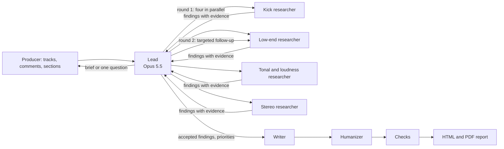

# Fix the Mix

Fix the Mix gives electronic music producers measured, section-aware feedback on a track. You upload your track and one to three reference tracks, say what each reference is for, and check where the intro, builds, drops and breakdowns are. A team of agents then measures the audio and compares it drop to drop and build to build. They return a report: what to change first, what to keep, and the charts behind every claim.

- **Live app:** https://fix-the-mix-347988227457.us-east1.run.app
- **Path:** Deep Research (Project 2). Solo project by Jan Barganowski (jgb2170).
- **Data:** in each run, the user supplies their own songs. The models have never heard these recordings; every number in a report comes from measuring them (see [Data](#data)).

> **A note from me:** yes, this is very technical and nerdy. But as a music producer, trust me, it is immensely helpful.

## Try it

1. Open the live app and click **Or try it with the demo tracks**. This loads my track *Scars* and three references, with comments already filled in.
2. The Lead reads the request and sums up the brief above the section editors. The demo's sections are already checked. Play or zoom them if you like (drag across the overview strip above each waveform), then press **Confirm all**.
3. The analysis takes about 5 minutes. The trace shows four specialist researchers running at the same time, then a targeted follow-up round.
4. Read the report, or download it as a PDF. Then ask follow-up questions in the box under the report: samples 2 and 3 below are good ones to try.

To use your own music, upload WAV or MP3 files of up to 30 MB and between 20 seconds and 10 minutes long. Every run uses real model calls on my API key, about $1.50 for a full report.

## Sample queries

These come from one demo run on the live app. [`scripts/sample_queries.py`](scripts/sample_queries.py) asked them exactly as the browser does. Sample 1 is the demo's request; samples 2 and 3 are follow-up questions typed under the report. The run cost $2.41 in all. Here is [its report](https://fix-the-mix-347988227457.us-east1.run.app/api/runs/939352d9-8b4c-43e7-8f2e-14834fbaa8d7/report) ([PDF](https://fix-the-mix-347988227457.us-east1.run.app/api/runs/939352d9-8b4c-43e7-8f2e-14834fbaa8d7/report.pdf)), and [the run itself](https://fix-the-mix-347988227457.us-east1.run.app/#run=939352d9-8b4c-43e7-8f2e-14834fbaa8d7) shows the trace. The raw replies, with every tool call, are in [`demo/samples/agent.json`](demo/samples/agent.json).

**Baselines.** [`scripts/baselines.py`](scripts/baselines.py) sent the same three questions, in one conversation, to the Lead's model (Claude Opus 5.5 through LiteLLM) with no tools and no system prompt. The first message gives what the producer types into the app: which track is which, the titles and the comments. The model gets no audio and no measurements. The Lead runs at high reasoning effort, the baseline at the default. The raw answers are in [`demo/samples/baseline.json`](demo/samples/baseline.json) ($0.11 for all three).

### 1. "Focus on the drops. I want the kick and bass to hit harder without losing the darker tone I have now."

The demo fills this in as the request, with a comment on each track (see [Data](#data)).

**What the agent did:**

- **Brief, 24 s.** The Lead recorded the goals, each reference's job and what to keep. It noticed that Reference 2's only build leads into its second drop, so it planned to compare that build-to-drop jump with both of yours.
- **Before round 1.** The Lead measured the section loudness and found kick candidates in your track and Reference 1.
- **Round 1.** The kick, low-end, tonal-and-loudness and stereo researchers started in the same second, and each finished 35–58 s later.
- **Round 2.** The Lead sent kick and low-end follow-ups in parallel:
  - Do drop 1's kick differences repeat on a drop 2 kick?
  - Is the extra energy below 40 Hz sustained between kicks (a sub bass) or lined up with them (the kick's tail)?
- **Finishing.** 58 findings accepted, 12 rejected, 3 priorities.
- **Report.** Writer, checks, Humanizer, then HTML and PDF: 403 s for the whole analysis.

**Agent's answer** (the summary shown when the analysis finishes):

> The main reason the kick feels buried looks like focus, not level. Your drops carry much more energy in the deepest sub (below about 40 Hz) than Reference 1, and less right around 44 Hz where Reference 1's kick weight sits. Your kick also sweeps lower, ending near 38 Hz against Reference 1's 43 Hz. From about 50 to 300 Hz you already match Reference 1, and your kick isn't quieter. So the priority is to tighten the sub (high-pass around 30 Hz, then try 35 Hz) and tune or shorten the kick's tail so it ends higher. None of that touches your darker top end. Second, your first drop already lifts more than Reference 2's, but drop 2 lifts less because build 2 is loud. Pulling build 2 down by about 1 dB should help. Third, drop 2 already peaks just over 0 dBTP, so keep an eye on the limiter as the kick gains weight. Keep your dark top, the mono low end, your current bass ducking and your stereo width. You don't need to add width to match Reference 3.

The report's priorities:

1. **Tighten the sub below 40 Hz and tune the kick body up toward Reference 1.** This is the clearest and most consistent difference behind the kick feeling buried. Both drops carry far more energy at 22-35 Hz than Reference 1 (35 Hz: -19.8 dB vs -36.65 dB in drop 1) but less at 44 Hz, and your kick's pitch sweeps down to about 38 Hz against Reference 1's 43 Hz, with a lower body peak and centroid on two separate kicks. Level from about 50 to 300 Hz already matches, and the kick's own level is not lower, so the fix is focus, not more level. These are low-end changes, so the darker top end stays as it is.
2. **Give drop 2 a bigger lift by pulling build 2 down.** Reference 2 is the target for the build-to-drop jump. Your build 1 into drop 1 jump (2.12 LU) is already bigger than Reference 2's first jump, but build 2 into drop 2 is 1.52 LU against Reference 2's 2.03 LU, because build 2 is louder (-8.70 LUFS vs -9.97 LUFS), not because drop 2 is quiet.
3. **Watch the true peak in drop 2 as the kick gets more weight.** This is the master: drop 2 reaches 0.37 dBTP, above 0 dBTP, and any extra kick and bass energy will push the limiter harder. Reference 1 also goes over, so this is a check, not a disaster.

<details>
<summary>The Lead's reply to the request, before the analysis</summary>

> I've set up the brief like this:
>
> **What you're after**
> - A harder-hitting kick and bass in the drops. You said the kick feels a bit buried under the bass, so the balance and separation between them is the main thing I'll look at.
> - **Keep:** your darker tone. I won't treat any reference's brighter top end as something to match.
> - This is your mastered version, so I'll compare loudness at equal peak level.
>
> **What each reference is for**
> - **Reference 1:** kick and bass weight in the drop, and how the kick sits against the bass.
> - **Reference 2:** how much louder it gets going from the build into the drop.
> - **Reference 3:** stereo width only, not its brighter top end.
>
> **One thing to check:** in Reference 2, the only section marked as a build leads into its second drop, not its first. So I'll compare its build-to-drop jump with both of yours (build 1 into drop 1, and build 2 into drop 2). Right now your build 2 isn't paired with any reference section. If a reference has a build before its first drop that isn't marked, adjust the sections.
>
> Please check the section times for all four tracks, especially the drops and builds, and confirm them. I'll start the analysis once they're confirmed.

</details>

<details>
<summary>Baseline: same model, no tools, no system prompt (verbatim, headings shown smaller)</summary>

I can't listen to audio, so I can't hear your master or the references. What I can do is give you a way to compare them yourself and the most likely fixes for a kick buried under bass in a dark-toned drop. If you measure the numbers below and share them, I can be more specific.

#### First: fix it before the master if you can

A kick buried under bass in a *mastered* file is usually a mix problem that the limiter made worse. If you have the stems or the session, do the work there. Then re-master, or ask your mastering engineer for less limiting in the drops. Working on the stereo master alone is possible but limited (see the last section).

#### 1. Kick and bass weight (Reference 1: Endless Light)

**How to compare:**
- Loudness-match a 4–8 bar section of your drop against their drop. Use short-term LUFS, not the whole-track integrated value. Without matching, the louder track will always seem better.
- On a spectrum analyzer with slow averaging, compare the 40–60 Hz and 80–120 Hz regions.
- Then solo the low end (low-pass around 150 Hz) and listen to the two tracks back to back. Ask whether the kick rises clearly above the bass, or whether the energy is a constant wall.

**Likely fixes that keep the tone dark:**
- **Give each element its own fundamental.** Decide whether the kick or the bass owns the sub (often roughly 45–60 Hz) and which one owns the punch region (roughly 80–120 Hz). Cut the other element a little in each zone. When both compete in the same band, you get buried kicks.
- **Duck more of the bass, and only in the lows.** Use a dynamic EQ or multiband compressor on the bass, sidechained to the kick, working only below about 150 Hz. Use a fast attack and set the release to match the tempo, so the bass recovers before the next kick. This adds punch without touching the bass's upper harmonics, which is where your dark character lives.
- **Add weight with low-mid saturation, not brightness.** Light saturation on the kick (tape or tube style) with a gentle low-pass afterward keeps it audible on small speakers. Avoid adding click at 3–5 kHz. That's the usual fix for buried kicks, but it would move you away from your tone.
- **Restore the transient.** Use a transient shaper on the kick with more attack. Or put a soft clipper before the limiter, so the limiter isn't squashing every kick hit.

#### 2. Loudness jump from build to drop (Reference 2: FE!N remix)

**How to measure:** Note the short-term LUFS over the last 2–4 bars of the build and the first 2–4 bars of the drop. Do this for both tracks and compare the difference (in LU), not the absolute levels.

**Likely fixes:**
- If your jump is smaller than the reference's, the fix is usually to **make the build quieter**, not the drop louder. Your drop is probably already near the limiter's ceiling.
- **Thin out the build's low end** (high-pass or remove the sub in the last bars). The drop's bass then feels like a bigger arrival even at the same peak level.
- **Keep the limiter working less in the drop.** If it's reducing gain heavily there, the drop's impact gets flattened. A brief drop-out or silence right before the drop also exaggerates the jump.

#### 3. Stereo width (Reference 3: Weightless), ignoring its top end

**How to compare:**
- Use a correlation meter or vectorscope, plus a mid/side solo, on the drop sections.
- Compare how much side energy each track has in the mids (roughly 200 Hz–5 kHz).
- To judge width without the brightness affecting you, low-pass both tracks around 6–8 kHz while comparing. Wider-sounding tracks often just have more top end, and you said you don't want that.

**Likely fixes:**
- Keep everything below about 120–150 Hz mono. This also helps your kick and bass hit harder.
- Get width from the mids: pads, chords, and returns from delays and reverbs. Don't apply a broadband stereo widener on the master.
- Watch that correlation doesn't go near zero or negative in the drop, or the low end will lose punch on mono systems.

#### If you only have the stereo master

- Use mid/side processing to make sure the sides below about 150 Hz are mono.
- Add a small cut to the bass's dominant low frequency. Use a dynamic EQ with a fast release so it mainly reacts to the bass's sustain between kicks.
- Lower the input gain to the final limiter in the drop sections and accept slightly lower loudness in exchange for punch.

These moves help, but they're less effective than separating the kick and bass in the mix.

#### What would help me give specific advice

- Short-term LUFS for the build and the drop, for your track and Reference 2.
- How much gain reduction your limiter shows during the drops.
- Whether you have the stems or session, or only the master.
- The key of the track, or the frequencies where the kick fundamental and the bass's root note sit.

</details>

**The difference.** The baseline says it can't hear the audio and gives a sound general checklist: sidechain the bass below 150 Hz, saturate the kick, add attack, make the build quieter. The agent measured where the problem actually is:

- Both drops carry far more energy at 22–35 Hz than Reference 1 and less at 44 Hz.
- The kick's pitch ends near 38 Hz against 43 Hz for Reference 1.
- From 50 to 300 Hz the two tracks already match, and the kick is not quieter.

It also found something the baseline could not know: drop 2 already peaks just over 0 dBTP.

### 2. "How does my build-to-drop loudness jump compare with Reference 2, and where does mine differ?"

**What the agent did:** one Lead call, 20 s, no new measurements. Round 1 had already measured every section's loudness, so it answered from that evidence.

**Agent's answer:**

> Your first drop lands as hard as Reference 2's. The second one is where you fall short, and the cause is the build, not the drop.
>
> **Into the first drop**
> - **Your track, build 1 into drop 1:** 2.12 LU jump in integrated loudness (from -9.25 to -7.13 LUFS).
> - **Reference 2, verse 1 into drop 1:** 1.27 LU (from -9.13 to -7.87 LUFS).
>
> On average your first jump is bigger than Reference 2's. If you look at the loudest moments (max short-term loudness) instead, it's slightly smaller: 1.33 LU against 1.51 LU. So the build 1 into drop 1 transition is fine overall. One caveat: in Reference 2 a verse comes before the first drop, not a build, so this isn't a perfect like-for-like comparison.
>
> **Into the second drop (the like-for-like comparison)**
> - **Your track, build 2 into drop 2:** 1.52 LU integrated, 1.68 LU at the loudest moments.
> - **Reference 2, build into drop 2:** 2.03 LU integrated, 2.27 LU at the loudest moments.
>
> Here your jump is smaller on both measures.
>
> **Where yours differs**
> - **Your drops aren't the problem.** At equal peak level, your drops measure -7.13 and -7.18 LUFS against Reference 2's -7.87 and -7.93 LUFS, so they're already louder.
> - **Build 2 is the problem.** It sits at -8.70 LUFS against Reference 2's build at -9.97 LUFS. It's also louder than your own build 1 (-9.25 LUFS), so the drop has less room to lift from.
> - **Less of a dip after drop 1.** Your build 2 comes in 1.57 LU below drop 1, while Reference 2's build sits 2.10 LU below its first drop. Reference 2 drops lower before the final drop, so the drop feels bigger.
>
> **What to try**
> Leave drop 2 as it is and bring build 2 down by about 1 dB. You can turn it down outright or thin out its low-mid and mid content. Then re-measure, aiming for a jump of about 2 LU like Reference 2's. Turning the build down doesn't add any brightness, so your darker tone stays as it is.
>
> One thing to keep an eye on: drop 2 already peaks at 0.37 dBTP, just over full scale. So get the extra lift by lowering the build, not by pushing the drop louder.

<details>
<summary>Baseline: same model, no tools, no system prompt (verbatim, headings shown smaller)</summary>

I can't tell you how they compare because I can't listen to or analyze audio. I haven't heard your track or the FE!N remix. If you take a few measurements, I can interpret them and tell you where yours differs.

#### What to measure (about 10 minutes)

Use any loudness meter with short-term LUFS (Youlean Loudness Meter is free) and a meter showing true peak or PLR/crest factor. For **both tracks**, note:

1. **Build level:** short-term LUFS averaged over the last 2–4 bars before the drop
2. **Drop level:** short-term LUFS over the first 2–4 bars of the drop
3. **The jump:** drop minus build, in LU
4. **Drop dynamics:** PLR (peak-to-loudness ratio) during the drop, or your limiter's gain reduction there if you have the session
5. **The transition:** whether there's a gap, riser cut, or filter sweep in the last beat or bar before the drop

Optionally, on a spectrum analyzer, compare the energy below about 100 Hz in the build versus the drop for each track.

#### How I'd interpret the results

| What you find | What it likely means | Direction to go |
|---|---|---|
| Your jump is smaller, and your **build is louder** than the reference's build | The build is eating your headroom | Pull the build down, or thin its low end |
| Your jump is smaller, and your **drop is quieter** than the reference's drop | The drop lacks density or level | Mix balance or limiting, more than arrangement |
| Similar jump, but your drop has **lower PLR** | Equally loud but more squashed, so it feels flatter and the kick suffers | Less limiting in the drop, a clipper before the limiter |
| Similar numbers, but the reference has a **gap or low-end cut before the drop** | The impact is coming from contrast, not level | Arrangement change: mute the sub or add a short silence |
| Reference build has **much less sub** than its drop, yours doesn't | Low-end contrast is doing the work | High-pass or remove the sub in your build |

The PLR row probably matters most for you. If your drop is limited harder than the reference's, that would also explain the buried kick.

Send me the numbers in roughly this form and I'll tell you specifically where yours differs and what to change:

- **Mine:** build ___ LUFS, drop ___ LUFS, drop PLR ___
- **FE!N remix:** build ___ LUFS, drop ___ LUFS, drop PLR ___

</details>

**The difference.** Both reach the same advice: ease the build rather than push the drop. The baseline guesses it and asks you to measure. The agent shows where it applies:

- Your first drop already lifts more than Reference 2's (2.12 against 1.27 LU).
- Your second drop lifts less (1.52 against 2.03 LU).
- The cause is build 2 at −8.70 LUFS, against −9.97 LUFS for Reference 2's build.

It also notes that Reference 2's first drop follows a verse, not a build.

### 3. "How does my stereo width in the drops compare with Reference 3, and what changes in mono?"

**What the agent did:** one Lead call, 13 s, from the stereo measurements round 1 had already made on both drops.

**Agent's answer:**

> Overall your drops are about as wide as Reference 3's, but the width sits in different places. Yours is in the highs, while Reference 3's comes more from the lows and mids.
>
> **Lows (below 120 Hz)**
> - **Your track:** side is -30.27 dB relative to the centre in drop 1 and -29.45 dB in drop 2, so it's essentially mono. Folding to mono changes the level by nothing (0 dB).
> - **Reference 3:** -15.94 dB in drop 1 and -19.05 dB in drop 2, so a bit wider. It still loses almost nothing in mono: 0.11 dB in drop 1 and 0.05 dB in drop 2.
>
> Your mono low end isn't a problem. It keeps the kick and bass centred and solid, which is what you want for more punch. I'd keep it.
>
> **Mids (120 Hz to 2 kHz)**
> - **Drop 1:** your side-to-centre is -5.25 dB against Reference 3's -5.68 dB, so you're about level.
> - **Drop 2:** yours is -4.44 dB against -3.05 dB, so Reference 3 is a little wider here.
>
> Both tracks lose a modest, similar amount in mono. This is the only band where you're narrower, and only in drop 2. If you want more width, add it here.
>
> **Highs (above 2 kHz)**
> - **Drop 1:** your side is -1.37 dB relative to the centre, almost as loud as the centre. Reference 3 is at -6.82 dB.
> - **In mono:** your highs lose 2.38 dB in drop 1 and 2.39 dB in drop 2. Reference 3 loses 0.82 dB and 1 dB.
>
> Your top end is clearly wider than Reference 3's and loses more when folded to mono. That fits with wide hats, reverbs or stereo-widened top layers, but the measurement can't tell which instruments cause it.
>
> **Correlation**
> - **Your track:** median left/right correlation of 0.83 in drop 1 and 0.79 in drop 2, with no out-of-phase moments.
> - **Reference 3:** 0.8 in drop 1 and 0.65 in drop 2. In drop 2, 4.11% of the short windows are out of phase, from a short stretch at its start.
>
> **What I'd do**
> - Leave everything below about 100 Hz centred. Don't add low-end width to copy Reference 3.
> - For a touch more width in drop 2, open up the 120–300 Hz region of the bass or pad layers slightly with mid/side EQ. Then check that the lows still lose nothing in mono.
> - Check your widest top layers in mono and pull back the width, or swap phase-based wideners for mid/side EQ. That should cut your high-band mono loss without boosting anything, so your darker top end stays the same.
>
> Reference 3's width doesn't come from its top end, so you don't need to make yours brighter or wider to match it.

<details>
<summary>Baseline: same model, no tools, no system prompt (verbatim, headings shown smaller)</summary>

I can't hear or analyze audio, so I can't tell you how your width compares to Weightless or what happens to your track in mono. Here's how to check both yourself, and how to read what you find. Send me the results and I'll tell you specifically where yours differs.

#### Measuring width (both tracks, drop sections only)

Loudness-match the two drops first. Then, for each track:

1. **Correlation:** Note the typical range on a correlation meter during the drop (e.g., mostly +0.3 to +0.7) and whether it ever dips below 0.
2. **Width by frequency band:** Use a band-split stereo analyzer (Voxengo SPAN in M/S mode, iZotope Insight, or similar). Note roughly where side energy starts. Many tracks are near-mono below 100–150 Hz and widest in the upper mids.
3. **Side level:** Solo the side channel (any M/S plugin) and compare how loud and full it is relative to the mid.

**Keeping the top end out of it:** Put a low-pass at about 6–8 kHz on both tracks while comparing. Weightless's brighter highs will make it *seem* wider even if its mid-range width is similar to yours. Judge width in the 150 Hz–6 kHz range, which is where you'd make changes anyway.

#### Checking what changes in mono

Sum to mono (a utility plugin or your monitor controller) and A/B the drop. Listen for:

- **Kick and bass:** Does the low end get louder, quieter, or hollow? Any change means there's stereo content down there. Given your buried-kick issue, this is worth checking first.
- **Pads, leads, and supersaws:** Do they drop noticeably in level or turn phasey? That points to wideners, chorus, or Haas-style delays causing cancellation.
- **Reverbs and delays:** These usually shrink in mono. That's normal unless they nearly vanish.
- **Balance shift:** If the kick suddenly sounds *louder* in mono, the wide elements were masking it in stereo.

Do the same mono check on Weightless. If it holds up better than yours, that tells you something even without numbers.

#### How I'd interpret it

| What you find | Likely cause | Fix |
|---|---|---|
| Yours is narrower in the mids, mono is fine | Not enough decorrelated mid content | Widen pads/chords at the source, or use wider stereo returns. Don't widen the master. |
| Yours is similar or wider, but correlation dips near/below 0 | Phase-based widening | Reduce widener amount, or replace it with doubled/panned parts |
| Low end changes in mono | Stereo content below ~150 Hz | Mono the lows (M/S high-pass on the sides). This also tightens the kick. |
| Elements disappear in mono | Heavy chorus/Haas/stereo-imager use | Pull those back, or keep a dry mono core under the wide layer |
| Reference only seems wider when unfiltered | Its brightness, not its stereo image | Nothing to fix. That's the top end you said not to chase. |

#### What to send me

- **Mine:** correlation range ___, frequency where side energy starts ___, what changes in mono ___
- **Weightless:** the same three things

</details>

**The difference.** The baseline expects the brighter reference to seem wider, and tells you to judge width below 6–8 kHz. The agent found overall width about equal but placed differently:

- **Lows:** yours are mono, Reference 3's are wider.
- **Mids:** about level, yours slightly narrower in drop 2.
- **Highs:** yours are much wider. They lose about 2.4 dB when summed to mono, against 0.8–1 dB for Reference 3.

It also caught a short out-of-phase stretch at the start of Reference 3's drop 2.

## Data

The data is the uploaded audio itself: the producer's unreleased or released track and their chosen references. A language model knows *about* mixing, but it has not heard these files. Even if it had, it could not say how many dB less body this drop's kick has than the reference's. The agents get numbers like that only by calling measurement tools on the audio.

**Demo corpus.** The demo button builds a run from these files, listed in [`demo/corpus.json`](demo/corpus.json) with their roles and comments:

| Role | Track | Origin |
|---|---|---|
| Your track | Jan Barg, ALPHUH: *Scars* (Extended Mix) | My own release |
| Reference 1, kick and bass weight | Jan Barg, Ønawa, Jeza: *Endless Light* (Radio Edit) | My own release |
| Reference 2, build-to-drop loudness | *FE!N* (Jan Barg Remix) | My remix; contains third-party material |
| Reference 3, stereo width (not its brighter top end) | it's murph: *Weightless* (Extended) | Third-party release |

The audio is not in this repository, because of its size and the third-party rights. The deployed app reads it from a private Cloud Storage bucket. To run the demo locally, put MP3s with the file names from `corpus.json` into `demo/audio/`. Any four tracks work, but only the original files start from my checked section maps.

**How a track is loaded.** Each upload is decoded with FFmpeg and normalised once so its loudest sample peak sits at 0 dBFS. Everything is measured on that one version, so build-to-drop contrast and channel balance survive and tracks mastered at different levels can be compared. A base analysis then finds the tempo, beat grid and bars, draws a three-band waveform and proposes sections. The producer corrects the sections in the editor before any research starts.

**Answer key for the section finder.** [`demo/section_truth.json`](demo/section_truth.json) holds 8 tracks that I sectioned by hand (17 drops), used to choose and tune the section finder (below).

## How it works



- **Lead** (Claude Opus 5.5) turns the producer's comments into a brief. It asks one short question instead when the request is too vague to act on. It sends the specialists focused questions, reviews what comes back and decides the priorities. It can run any measurement itself, or a second and third research round when a finding needs checking (at most three rounds).
- **Four specialist researchers** (Claude Sonnet 5.5): kick, low end, tonal balance and loudness, stereo. Each runs in a fresh context with only the evidence the harness measured for it: numbers plus the charts as images. Each returns observations, comparisons, hedged interpretations and experiments to try, all citing that evidence. A values check flags any number that does not match the evidence, and the Lead rejects those findings.
- **Writer** (Opus 5.5) turns the accepted findings into the report. Code then checks every number, chart link and required section, and the Writer gets one chance to repair what fails. In the report, each number links to the measurement it came from.
- **Humanizer** (Opus 5.5, adapted from the Humanizer skill) rewrites the prose so it reads less like a model. Any edit that changes a number, a track name, a section name or a hedge is undone.
- **Follow-up questions** after the report go back to the Lead. It answers from the evidence it already has, or measures something new first.

**Tools.** The agents call these Python tools on the audio. They are written for this project with NumPy, SciPy, librosa and FFmpeg:

| Tool | What it measures |
|---|---|
| `measure_loudness` | Integrated and short-term LUFS, true peak and loudness range per track and section, section-to-section lift in LU. Chart: all tracks on one timeline, lined up at the first drop |
| `measure_tonal_balance` | 1/6-octave spectrum per track or section, and the difference from each reference |
| `measure_stereo` | Side-to-mid ratio by frequency band, left/right correlation over time, and how much each band changes when summed to mono |
| `find_kick_candidates` | Ranks the kicks in a section by how full and exposed they are, so a kick buried under a bass note is not analysed as if it were clean |
| `analyse_kick` | Attack against body, decay time, body pitch, spectrogram of one chosen kick |
| `measure_low_end` | 20–300 Hz distribution, low-band envelopes lined up on every kick, and how deep the bass ducks and how fast it recovers |
| `render_spectrogram` | Spectrograms of any passage, on one colour scale for all tracks |

**Trace.** `POST /chat` keeps the starter's response shape (`response`, `session_id`, `tool_calls` with `name`, `args`, `result`). Each tool call also says which agent made it (`lead`, `kick researcher`, …), its round, and its start and end times. The app draws the researchers as overlapping bars, so you can see they run in parallel.

[SPEC.md](SPEC.md) is the product specification and [DESIGN.md](DESIGN.md) the technical design, with every decision and the measured results of the development runs.

## Section finder: approaches and hill-climbing

Every comparison is drop against drop and build against build, so the sections matter. The app proposes them and the producer corrects them. The first finder found only 8 of the 17 drops in my hand-made maps. It measured the kick by comparing the low end just after each beat with the low end late in the beat. With the bass on the offbeat or rolling, that late window is full of bass, so a full drop read as "no kick" and was called a breakdown.

I turned my own rules of thumb into per-bar features on a 4-bar grid:

- **Builds:** less and less low end as the section goes on (a high-pass rising before the drop). Feature: the slope of the 30–120 Hz level.
- **Breakdowns:** a clear drop in energy, especially low end, and fewer hat and snare hits on the beats and offbeats. Features: the low-end level and a 6–16 kHz hat pulse.
- **Verses** start on the downbeat where the vocal comes in. Feature: a change in the shape of the 200 Hz–5 kHz spectrum.
- **New:** a low-end pulse measured through the whole beat, which reads the same whether the peak is a kick on the beat or a bass on the offbeat.

Three approaches use the same features:

- **N, cut then label:** cut at the biggest changes, then label each piece by rules.
- **R, drops first:** a drop starts where the full low end comes back after a dip; then builds before drops, breakdowns, and the rest split at the biggest changes.
- **V, sequence:** score every bar for each section type and take the best sequence (Viterbi, with a bonus for entering a drop where the low end comes back).

The score favours drops, because my own labels are imperfect too:

- 45%: drop time agreeing (F1 over time)
- 20%: drops found (F1 over sections)
- 20%: boundaries within one bar
- 15%: coarse labels agreeing

Hill-climbing started from hand-set values. It changed one or two settings at a time and kept a change when the mean score over the 8 tracks did not drop, with 4 random restarts of 1,500 steps per approach. Eight tracks are easy to overfit, so I also scored each approach leave-one-track-out: tune on 7 tracks, score the 8th.

| Finder | Score, tuned on all 8 | Leave-one-out | Drops found (leave-one-out) |
|---|---|---|---|
| First version | 0.33 (not tuned) | — | 8 / 17 |
| N, cut then label | 0.76 | 0.44 | 9 / 17 |
| V, sequence | 0.71 | 0.58 | 14 / 17 |
| R, drops first | 0.81 | 0.71 | 17 / 17 |

These scores use the corrected answer key. My first map of *Scars* called its second drop a build. It starts with one hit, a short gap, then the 4/4 beat. Fixing that label made 17 drops instead of 16.

The app uses R. Untuned it already scores 0.65, so the rules carry most of the gain, not the tuning. Its settings were tuned before the fix. With them it scores 0.76: it finds 15 of the 17 drops, and 16 of the 17 drops it proposes are real. Re-tuned on the corrected key, R finds all 17.

Its weak spots:

- Boundaries between drops, such as where a vocal comes in.
- *Scars*' second drop, which those settings learned to treat as a build. The re-tuned lab version compares the comeback with the lowest bar in the previous 12 bars, not just the previous 2, and catches it.
- A drop whose low end comes back in two steps. In *Weightless* the low end comes back halfway at 2:02 and fully at 2:06, and the next comeback is taken for the drop instead.

The lab is in [`scripts/section_lab/`](scripts/section_lab/). It needs the audio, so it runs only on my machine:

```bash
PYTHONPATH=. SECTION_AUDIO=/folder/with/the/other/four/mp3s uv run python scripts/section_lab/run.py R loo 800
```

## What it can't tell you

- It never hears the music. It can say the kick has less body than the reference's and the bass ducks deeper, but not whether the song is good.
- Kicks are not separated from the mix. When every kick sits on a bass note, kick claims are limited, and the report says why.
- A ducking recovery time is reported only where the bass is steady enough to show a baseline.
- Section proposals are suggestions; the producer confirms them, and the demo starts from maps I corrected.
- The Lead's chat replies are not number-checked the way the report is. Its prompt tells it to quote measured values only.

## Validation

- `uv run pytest` runs 81 tests in about 20 seconds, with no network. The measurement tests use synthetic signals whose answers are known from how they are built: a full-scale sine reads 0 LUFS, a sidechained bass recovers on schedule, a polarity-flipped channel cancels in mono, and drops with an offbeat bass are found after builds whose bass fades out. The agent tests use a scripted fake model. They check parallel researchers, the round cap, clarification, interrupted runs and the report checks.
- Real runs on the demo corpus are logged in DESIGN.md §12. The sample run above took 403 s for the analysis: two research rounds, 58 findings accepted and 12 rejected, and 3 priorities. With the brief and both follow-ups it cost $2.41.
- Two behaviours were tried on the live app. With the comments cleared, "make it better" and "idk something feels off, can you take a look" each got a clarifying question and no brief, and the brief followed once the question was answered. Asked which compressor Reference 1 used and how it was set, the Lead said a finished master can't show that, and gave what it had measured instead.

## Run it locally

Needs Python 3.12, [uv](https://docs.astral.sh/uv/), FFmpeg, and Pango for the PDF (`brew install ffmpeg pango` on a Mac).

```bash
uv sync
cp .env.example .env   # then add your ANTHROPIC_API_KEY
uv run uvicorn app.main:app --reload
```

Runs are stored in `.data/` locally and in the bucket on Cloud Run (`STORAGE=gcs`). Each role's model is an env var (`LEAD_MODEL`, `RESEARCHER_MODEL`, `WRITER_MODEL`, `HUMANIZER_MODEL`), so any of them can switch to Gemini through LiteLLM. The sample queries and baselines above come from two scripts:

```bash
uv run python scripts/sample_queries.py          # the three samples on the live app → demo/samples/agent.json
PYTHONPATH=. uv run python scripts/baselines.py  # same model, no tools, no system prompt → demo/samples/baseline.json
```

## Deploy

A push to `main` that changes the app (`app/`, `static/`, `demo/corpus.json`, `Dockerfile`, `pyproject.toml` or `uv.lock`) deploys it: a Cloud Build trigger on this repository builds the image and updates the Cloud Run service, keeping its settings and secret. The command below creates the service or deploys by hand.

```bash
gcloud run deploy fix-the-mix --source . --project agentic-ai-msds --region us-east1 \
  --service-account fix-the-mix-run@agentic-ai-msds.iam.gserviceaccount.com \
  --cpu 4 --memory 8Gi --cpu-boost --timeout 3600 --max-instances 1 --concurrency 8 \
  --set-secrets ANTHROPIC_API_KEY=fix-the-mix-anthropic-api-key:latest \
  --set-env-vars STORAGE=gcs,BUCKET=agentic-ai-msds-fix-the-mix \
  --allow-unauthenticated --quiet
```

Each analysis runs inside its HTTP request, so the service runs on one instance with a 60-minute request timeout.
