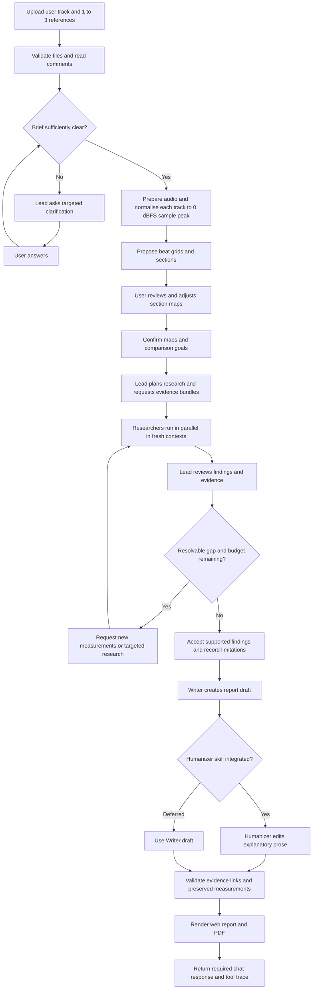
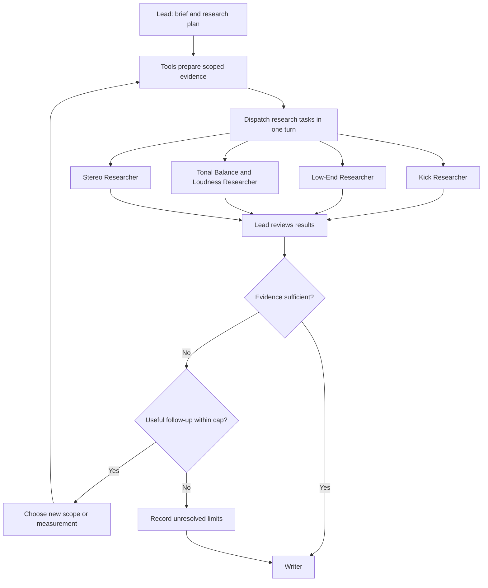
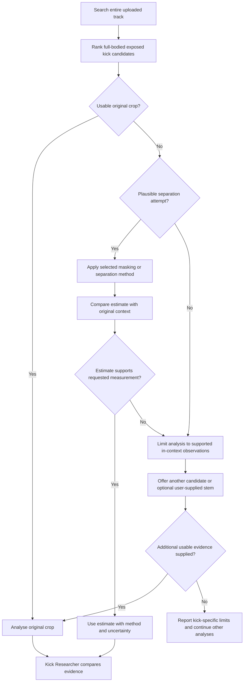
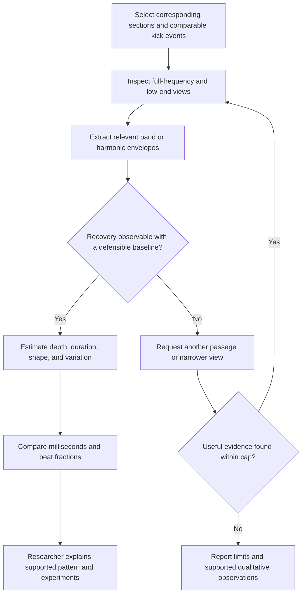
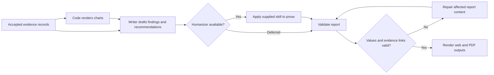
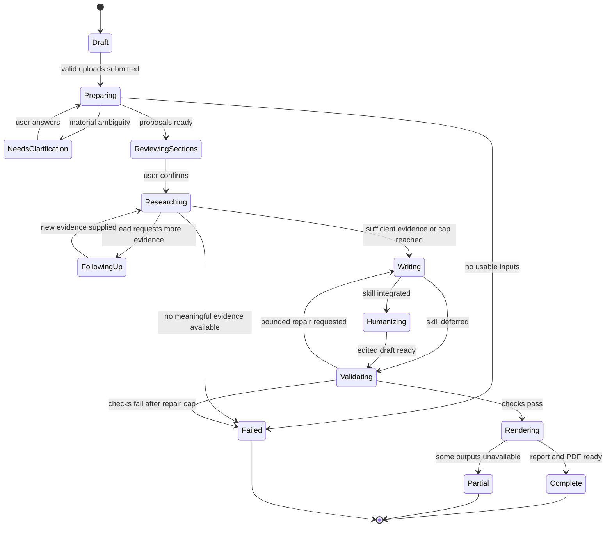
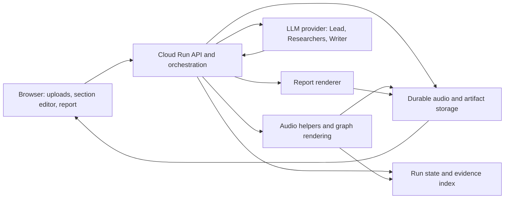

# Electronic Music Mixing & Mastering Feedback Agent

**Product and implementation specification · Draft 2 · November 3, 2026**

**Project:** Agentic AI, Project 2 — Data Exploration Agent  
**Path:** Deep Research  
**Team:** Solo  
**Deadline:** November 11, 2026

This document captures the agreed product design. It describes intended behaviour, not an already implemented system. Items marked **Proposed default**, **Optional**, or **Open decision** are implementation recommendations rather than settled requirements. The Humanizer is part of the planned architecture; its skill integration is deferred.

This specification will serve as the project's main design document when the repository is set up. The user will supply the Humanizer skill later; its contents will become instructions for the Humanizer agent.

## Contents

1. [Purpose and scope](#1-purpose-and-scope)
2. [Inputs and user interface](#2-inputs-and-user-interface)
3. [End-to-end flow](#3-end-to-end-flow)
4. [Agent responsibilities and orchestration](#4-agent-responsibilities-and-orchestration)
5. [Audio tools and evidence generation](#5-audio-tools-and-evidence-generation)
6. [Comparison rules](#6-comparison-rules)
7. [Evidence and citation contracts](#7-evidence-and-citation-contracts)
8. [Report and graphs](#8-report-and-graphs)
9. [API, trace, and run state](#9-api-trace-and-run-state)
10. [Fallbacks and failure behaviour](#10-fallbacks-and-failure-behaviour)
11. [Implementation and deployment](#11-implementation-and-deployment)
12. [Assignment alignment and validation](#12-assignment-alignment-and-validation)
13. [Implementation order and open decisions](#13-implementation-order-and-open-decisions)
14. [Technical references](#14-technical-references)

## 1. Purpose and scope

### 1.1 Product definition

An electronic music producer uploads one of their own tracks and one to three reference tracks. The agent investigates how the user's track compares with those references, using whole-track measurements, matching musical sections, and detailed inspection of kicks, low-end behaviour, tonal balance, loudness, and stereo information.

The result is a visual report that explains:

- What differs from each reference or a combined target requested by the user.
- What is already working and should be preserved.
- Which differences matter for the user's stated intentions.
- What changes the user could try and how to evaluate them.
- What the available audio cannot establish reliably.

The system provides feedback and experiments for the producer to perform. Automatic mixing, mastering, editing of the uploaded song, and guaranteed reconstruction of production settings are outside the initial scope.

### 1.2 Target user

Electronic music producers who have a mix or master in progress and specific reference tracks, but want help identifying and prioritising differences. The interface should be usable without understanding the internal agents or signal-processing implementation.

### 1.3 Research questions

Examples of the questions this system should investigate:

- How do my kick's characteristics compare with the kick in Reference A?
- How tight are my kick and bass compared to Reference B?
- Does the tonal difference persist after matching the level of comparable sections?
- How does the loudness progression from build to drop differ from Reference B?
- How does my stereo width and tonal balance match up against those in the reference tracks?
- Which three changes would best support my stated goals, and what should I leave alone?

### 1.4 Design principles

1. **Measurements come from tools.** Language models interpret evidence and request further investigation; they do not invent measurements from descriptions or visually estimate precise values that a helper can calculate.
2. **References don't need to remain separate.** The system can average (or combine specific elements from different songs) tracks into a ballpark reference, if the user specifies so.
3. **Musical context matters.** Whole-track summaries and corresponding-section comparisons answer different questions.
4. **Observed behaviour and inferred causes remain distinct.** A visible recovery envelope can support a ducking hypothesis without revealing the exact compressor settings.
5. **Research is adaptive.** The Lead follows gaps and contradictions with targeted additional work, within a cap.
6. **The output includes strengths.** Similarity to a reference is not the only measure of quality; intentional differences can be preserved.
7. **Every substantive claim has evidence or is explicitly framed as a hypothesis or suggested experiment.**

## 2. Inputs and user interface

### 2.1 Upload screen

The screen explains the product's purpose, intended audience, and usage before the upload controls.

```text
Global comments / requests
┌──────────────────────────────────────────────────────────────┐
│ Overall goals, concerns, constraints, and things to preserve   │
└──────────────────────────────────────────────────────────────┘

Your track — required             Reference 1 — required
┌──────────────────────────┐     ┌──────────────────────────┐
│ Drop audio / choose file │     │ Drop audio / choose file │
│ Track comments           │     │ What to reference here   │
└──────────────────────────┘     └──────────────────────────┘

Reference 2 — optional            Reference 3 — optional
┌──────────────────────────┐     ┌──────────────────────────┐
│ Drop audio / choose file │     │ Drop audio / choose file │
│ What to reference here   │     │ What to reference here   │
└──────────────────────────┘     └──────────────────────────┘

                         [Prepare tracks]
```

Layout may adapt to screen size; the global comments area remains above all upload areas.

| Input | Requirement | Purpose and examples |
|---|---|---|
| User track | Exactly one | The mix or master being assessed |
| Reference tracks | Minimum one; maximum three | Individual references or a combined target when requested |
| Global comments | Optional free text | “Focus on the drop. I like the darker tone I have now.” |
| User-track comments | Optional free text | “This is an unmastered mix. The bass feels disconnected from the kick.” |
| Comment on each reference | Optional free text | “I want the bass from this song”; “Use this for loudness progression”  |

**Supported initial formats:** WAV and MP3. Additional formats, upload-size limits, and duration limits must be chosen and displayed before implementation is considered complete.

The primary workflow accepts audio files. Retrieving songs from streaming links or searching for an extended mix is not part of the initial scope. If an extended mix is useful, the user uploads it as the relevant reference file.

### 2.2 Interpreting comments and clarification

The Lead converts the global and per-track comments into an analysis brief containing:

- User goals and stated concerns.
- Constraints and qualities to preserve.
- The intended role of each reference.
- Whether the user wants separate comparisons, selected aspects from different references, or an averaged target.
- Relevant sections or timestamps mentioned by the user.
- Whether the uploaded user track is a mix or master, if known.
- Questions whose ambiguity would materially change the investigation.

Examples:

| Input | Behaviour |
|---|---|
| “Bass from A, build-to-drop loudness progression from B” | Assign separate reference goals and proceed |
| “Use the average tonal balance of these references” | Build a combined comparison target from compatible measurements and explain the combination method |
| No comments, using a clearly labelled general-comparison option | Explain the default comparison scope and proceed |
| “Make it better” with no meaningful goal | Ask a concise clarification before starting substantive research |
| “Make it as loud as the reference” but production stage is unclear | Clarify whether the user wants mixing feedback or a mastered-level target |
| Global instruction conflicts with a reference comment | Ask which intention should govern the affected comparison |

Clarification is a conversational step, not a long mandatory questionnaire. Available file validation and preparation may continue while waiting; decisions that depend on the answer must wait.

### 2.3 Section review screen

Each uploaded track has a Rekordbox-inspired waveform and phrase editor. The system proposes sections, and the user can correct them before the main research run.

The interaction is inspired by Rekordbox's editable phrase workflow; it does not depend on Rekordbox software or promise equivalent detection accuracy. See the [official phrase-editing guide](https://cdn.rekordbox.com/files/20200312172204/rekordbox5.1.0_Phrase_Edit_operation_guide_EN.pdf).

Required capabilities:

- Coloured section blocks over or adjacent to a waveform.
- Musical labels such as intro, build, drop, breakdown, verse, chorus, bridge, and outro, with an unknown/custom option.
- Beat and bar markers to support editing.
- Draggable boundaries with grid snapping and a way to disable snapping.
- Split, merge, and relabel operations.
- Playback around boundaries.
- Correction of BPM and downbeat alignment when the proposed grid is wrong.
- Acceptance of the current map without requiring changes.

The initial label set and detector are open decisions. Electronic music does not require every label, and a detected chorus must not automatically be treated as a drop.

User-confirmed edits become the authoritative section map for that run. A later reanalysis must not silently overwrite them. Changes create a new map version and invalidate affected derived results.

### 2.4 Progress and results

Show plain-language progress such as “Preparing tracks,” “Review sections,” “Comparing low-end,” “Checking a difference,” and “Writing report.” Also provide access to the detailed tool trace.
The user-facing messages for these should be fun, Claude-inspired tags, such as:
"Feeling the bass thump in the chest", "Asking the DJ for Track ID", "Dancing my ass off", "Crying in the club rn", "Plugging it through an analog speaker", "Mono-Stereo-Mono-Stereo... ARGHHHHHHH", etc.

The results screen provides the report, supporting graphs, source timestamps, a downloadable PDF, and a way to ask follow-up questions. Follow-ups reuse valid evidence and request new measurements when their scope requires it.

## 3. End-to-end flow



The preparation/clarification steps may overlap for efficiency. The diagram describes the logical gates: confirmed intent and section maps are required before dependent comparisons are treated as final.

## 4. Agent responsibilities and orchestration

### 4.1 Agent roles

The core role shapes are **Lead**, **Researcher**, and **Writer**. Researchers have different specialist instructions. The Humanizer is a later editorial role.

| Agent | Responsibilities | Receives | Returns |
|---|---|---|---|
| Lead | Clarify, plan, delegate, supply evidence, review contradictions, request follow-up, stop at cap | User brief, track/section metadata, available tools, researcher findings | Research tasks, tool requests, accepted findings, remaining limitations |
| Kick Researcher | Compare exposed full-bodied kick candidates across tracks | Original and optional estimated kick crops, spectrograms, measurements, selection rationale | Kick observations, comparisons, hypotheses, experiments, evidence gaps |
| Low-End Researcher | Compare bass energy, kick/bass interaction, and ducking/recovery behaviour | Full-frequency and low-frequency views, band envelopes, kick timing, section context | Low-end findings, observed recovery estimates, interpretation limits, follow-up requests |
| Tonal Balance & Loudness Researcher | Compare spectral balance, loudness, dynamics, and section progression | Whole-track peak-normalised measurements, spectra, loudness timelines, section maps, and any explicitly labelled secondary timbre comparisons | Broad tonal/loudness findings, transition contrasts, recommended experiments |
| Stereo Researcher | Compare stereo distribution and mono behaviour | Stereo/mono measurements, mid/side and correlation views, matching sections | Width and mono findings, limitations, recommended experiments |
| Writer | Synthesize accepted findings into the specified report | Accepted evidence-backed findings, goals, charts, limitations | Structured report and readable prose |
| Humanizer — deferred | Apply the user's existing Claude skill to improve report language | Writer draft and protected evidence references | Edited prose preserving factual content and uncertainty |

Kick and Low-End findings overlap deliberately. The Lead reconciles them. Tonal Balance & Loudness still sees the whole spectrum for context but avoids duplicating the detailed low-end investigation.

### 4.2 Lead fan-out and review loop

The Lead dispatches several researcher tasks in **one orchestration turn**, and they execute concurrently in **fresh contexts**. Merely calling specialists sequentially or passing one long shared conversation through multiple names does not satisfy this design.

Each task includes a focused question, relevant user intent, selected track/section IDs, an evidence bundle, and the expected output format. A researcher's context does not automatically include another researcher's private conversation.



A full report ordinarily invokes all four specialisms. If a particular analysis is inapplicable, the result records why. Follow-up rounds may invoke only the specialists needed to resolve the remaining question.

**Proposed default:** maximum three research rounds: one initial fan-out and up to two follow-up rounds. This is configurable. Retries caused by service errors are bounded separately and do not masquerade as research progress.

### 4.3 Tool access versus helper execution

Researchers may be tool-free. The Lead must have a way to request real data retrieval or analysis through callable tools.

A tool may run deterministic helpers and then invoke a researcher with the resulting evidence. The researcher interprets that evidence and returns structured findings or requests for more information. The Lead decides whether and how to obtain the additional evidence.

Precomputation is allowed for expensive reusable measurements. The Lead must still be able to select new scopes, retrieve detailed evidence, or request further measurements. A fixed one-pass pipeline with no meaningful follow-up does not meet the intended Deep Research behaviour.

### 4.4 Follow-up examples

| Initial finding or gap | Lead action | What the next pass resolves |
|---|---|---|
| Whole-track low-end differs | Request matching-drop analysis | Whether arrangement length explains the aggregate difference |
| An apparent long kick tail may include bass | Inspect another candidate and its original context | Whether a kick-specific claim is supportable |
| Ducking seems different across frequency bands | Request full-frequency crop and band recovery views over comparable repeated events | Whether the pattern is consistent or obscured by other sources |
| Stereo and tonal findings appear to disagree | Check mono fold-down and normalisation metadata | Whether they describe different signals or a genuine contradiction |
| Two references imply opposite changes | Revisit the user's reference roles and any requested combination | Whether to use a specified aspect, an agreed combined target, or explain the trade-off |
| A researcher lacks evidence for a numerical claim | Request the missing measurement or remove the claim | Prevent unsupported precision |

The Lead must not keep rerunning the same analysis without a specific unresolved question and a reason new evidence may help.

### 4.5 Writer and Humanizer

The Writer receives accepted findings, not an instruction to invent a coherent story from incomplete measurements. It prioritises findings according to the user's goals and preserves limitations.

The Humanizer runs after the Writer and before final report rendering. Its actual skill and model integration are deferred until the user supplies them. Do not silently replace the user's skill with a generic prompt or claim it ran when it did not.

Protected content includes numerical values, units, track and section identities, timestamps, internal evidence links, descriptive source captions, and the distinction between observation, hypothesis, and recommendation. Internal identifiers are not printed in the report. Charts and the tool trace remain structured artifacts. Automatic checks can catch changed values and broken links; preservation of meaning and uncertainty also requires explicit editorial instructions and review.

While Humanizer integration is deferred, the system can render the Writer's draft and record that the editorial stage was skipped.

## 5. Audio tools and evidence generation

### 5.1 Implementation constraint

**No dependency on iZotope RX or a manually operated desktop audio application.** The project must generate and analyse its own spectrograms and audio measurements through code and available libraries.

RX was an example of time–frequency editing, not a proposed runtime component. Existing libraries supply signal-processing primitives; the project supplies task selection, candidate ranking, comparison logic, evidence records, and agent interpretation.

### 5.2 Tool inventory

These are logical tool capabilities, not a fixed API naming scheme.

| Capability | Main inputs | Main outputs |
|---|---|---|
| Inspect and prepare audio | Uploaded file | Validated metadata, original signal, whole-track 0 dBFS sample-peak analysis copy, applied gain, immutable source identity |
| Analyse beat grid and structure | Audio, optional corrections | BPM/grid proposal, candidate boundaries and labels |
| Retrieve section evidence | Track, confirmed section or time range | Scoped audio, measurements, images, provenance |
| Find kick candidates | Track, optional preferred ranges | Ranked candidate crops, selection reasons, contamination flags |
| Estimate kick extraction | Candidate and chosen method | Estimated component, method metadata, original comparison, limitations |
| Measure tonal balance and loudness | Track/section, comparison mode | Spectra, band energy, loudness, peaks, dynamics |
| Measure low-end and recovery | Matched sections, event timing, selected bands | Band envelopes, event-aligned views, recovery estimates where supported |
| Measure stereo and mono | Stereo signal, section, fold-down convention | Mid/side, correlation, mono changes, availability flags |
| Render evidence graphs | Numeric evidence and display specification | Charts with plain-language source captions and internal evidence links |
| Run researcher | Task, instructions, scoped evidence | Structured findings and follow-up requests |
| Render report | Validated report and figure references | Web report and downloadable PDF |

### 5.3 Audio preparation

- Retain the original uploaded file and its identity.
- Record sample rate, channel count, duration, encoding, and decoding errors.
- Preserve stereo information; do not implicitly convert all inputs to mono.
- If analysis requires resampling, record the transformation and use consistent settings.
- Create an analysis copy of every user track and reference, normalised to **0 dBFS sample peak across the entire track**. Apply one constant gain to all channels; preserve the original file separately.
- Measure the peak after decoding and any shared resampling, before downstream analysis. All sections inherit their parent track's gain. Do not normalise each section or channel independently.
- Record the original peak and applied gain. Primary loudness results come from the peak-normalised copies; original-level measurements remain available for explicitly requested diagnostics.
- Store reusable measurements once per applicable input/configuration version.
- Treat silence, insufficient duration, and unavailable metrics explicitly; do not replace them with plausible values.

### 5.4 Section detector

The section detector proposes musical structure. BPM and downbeats provide the editing/alignment grid; they do not by themselves identify a build or drop.

Candidate boundaries and labels may use changes in energy, spectral content, rhythmic activity, repetition, or a suitable pretrained structure model. The exact detector is an open decision requiring a small feasibility check on electronic music.

The user can correct the proposal. When automatic detection is weak, retain a useful waveform/grid editor and permit manually defined sections. Do not present uncertain labels as established musical facts.

### 5.5 Spectrograms and numerical evidence

Keep the underlying numerical time–frequency representation, not just an image. If reconstructing an estimated component after masking, retain the information needed for that reconstruction, including phase where the method uses it.

Researchers receive:

- A whole-track or section overview for orientation.
- Focused crops with enough detail for the actual question.
- Numerical measurements supporting quantitative claims.
- Frequency/time axes, colour-scale meaning, analysis settings, and normalisation mode.
- The exact source track and time range.

Use consistent comparison scales. Independently auto-scaled images can make different levels look identical or exaggerate differences. A display rescaling is allowed only when explicit and appropriate to the question.

Do not force one spectrogram configuration to serve every task. A view suited to low-frequency detail may smear short transients. Choose time/frequency resolution for the question, record the settings, and avoid reporting more timing precision than the analysis supports.

### 5.6 Kick finder and kick analysis

#### Selection objective

Find the fullest, most exposed usable kick anywhere in each uploaded track. An extended intro is a promising location when available, but the search is global.

Prefer candidates with:

- A clearly defined attack and inspectable decay.
- Substantial low-frequency body rather than an obviously filtered variation.
- Useful upper-frequency attack information where present.
- Limited overlap with bass, hats, crashes, or other sounds.
- Consistency with repeated full-bodied kicks elsewhere in the track.

The user's intention is the loud, substantial, extractable version of the kick. Rank candidates using both fullness and isolation; the largest waveform peak alone may represent overlapping sources or an exceptional hit.

Retain multiple candidates, their timestamps, and their selection reasons. Provide a way for the user to audition or override the chosen candidate. A candidate from one section remains labelled with that source; do not silently assume it represents every kick variation in the song.

#### Fallback flow



Time–frequency masking can remove material that is separable in the representation. It does not automatically disentangle kick and bass occupying the same bins. A source-separated signal is an estimate, not recovered ground truth.

If a general source-separation model is used, check its output categories: a drums stem is not automatically an isolated kick. For example, the documented Demucs stem categories include drums, bass, vocals, and other. [Demucs documentation](https://github.com/facebookresearch/demucs)

#### Research questions and outputs

Compare attack/body balance, apparent decay, spectral emphasis, and candidate levels under a documented comparison method. Kick pitch or tonal trajectory is reported only where sufficiently identifiable.

Kick crops inherit their parent track's whole-track peak-normalisation gain for level-related comparisons. An additional, clearly labelled gain-matched candidate view may be used to investigate timbre or shape; it does not replace the primary level measurements. Do not equate the level of an estimated stem to the original mix's kick fader level, especially if extraction changes gain.

Recommendations may include adjusting level, envelope, tonal balance, or testing another sample. Sample replacement is a possible experiment, not an automatic conclusion from an uncertain extraction.

### 5.7 Low-end and ducking recovery

The Low-End Researcher focuses on bass and kick interaction, but has access to **full-frequency spectrograms** so it can inspect bass harmonics and distinguish candidate frequency-dependent patterns.

Roughly 300 Hz is an initial area of interest, not a universal boundary. Band definitions are configurable and recorded. A low-pass-filtered mix contains all sources in that range; it is not an isolated bass stem.

Investigate:

- Energy distribution through the sub and bass regions.
- Sustained versus transient behaviour and apparent kick/bass overlap.
- Repeated dips and recovery around kick events.
- Whether visible upper bass harmonics move together with the low frequencies.
- Differences across corresponding sections and references.

#### Recovery measurements

The intended output is **observed ducking recovery**, not the exact release value from an unknown compressor.

Where the signal supports it, estimate:

| Quantity | Interpretation |
|---|---|
| Apparent dip depth | Observed attenuation relative to a locally justified baseline; not automatically true gain reduction |
| Recovery duration | Time from the identified dip/minimum toward a defined local recovery level |
| Musical duration | The same duration expressed as a fraction of the local beat |
| Recovery shape | Quick return, gradual swell, delayed return, or other supported envelope description |
| Frequency dependence | Whether selected bands or visible bass harmonics recover together |
| Repeatability | Variation across comparable events and sections |

**Open decision:** choose and validate the exact recovery criterion, such as a specified fraction of the observed dip or proximity to an estimated local baseline. Record this criterion with every estimate. A baseline may be unidentifiable in a changing bass phrase; in that case, do not manufacture a recovery time.

Inspect multiple comparable events. A kick itself can add energy where the bass is ducking, and changing notes or arrangements can imitate envelope changes. If recovery is obscured or interrupted by the next event, mark the estimate unavailable or qualified rather than returning a precise release value.

The report may infer that behaviour is consistent with broadband or frequency-selective ducking when the evidence supports it. It must not claim to identify the exact routing, compressor, multiband configuration, automation, or release knob setting solely from the finished mix. Actual compressor recovery can depend on programme material and operating mode. [FabFilter time-control documentation](https://www.fabfilter.com/help/pro-c/using/timecontrols)



### 5.8 Tonal balance, loudness, and dynamics

Compute and compare full-track and section-level spectral summaries and time-varying loudness. **All primary loudness comparisons use tracks normalised to 0 dBFS sample peak.** This equalises their maximum sampled amplitude, not their LUFS or perceived loudness; those remaining differences are part of the analysis. Distinguish the following units:

| Measurement | Unit / representation | Main use |
|---|---|---|
| Integrated loudness | LUFS | Whole track or sufficiently supported selected region |
| Short-term loudness | LUFS | Loudness over a moving window and section progression |
| Momentary loudness | LUFS | Optional finer temporal context |
| Sample peak | dBFS | Largest sampled amplitude; 0 dBFS for each whole-track analysis copy, with section peaks allowed to be lower |
| True peak | dBTP | Estimated inter-sample peak level, measured separately from the sample-peak normalisation target |
| Band energy / RMS | Explicitly defined linear or dB measure | Tonal and envelope comparisons; not casually labelled LUFS |
| Spectral curve | Labelled magnitude/power and averaging convention | Tonal distribution |
| Dynamics descriptor | Defined formula and unit | Optional supporting context, when useful |

These are measurement conventions, not a prescribed loudness target. Do not import a broadcast target or generic mastering number as the ideal for every electronic track. The [EBU loudness documentation](https://tech.ebu.ch/loudness/) describes the distinction between loudness measurements and peak handling.

Compute build-to-drop and other progression comparisons from the whole-track peak-normalised copy. A constant gain preserves the track's internal level differences. Do not independently normalise builds and drops or match their LUFS before this analysis. An unmastered mix compared with a mastered reference still requires that distinction in the interpretation.

### 5.9 Stereo and mono analysis

Compare corresponding sections and the overall track using defined measures of stereo distribution and mono behaviour. Candidate evidence includes correlation over time, frequency-dependent mid/side energy, a stereo-field display, and tonal/level changes after mono fold-down.

Record the fold-down and mid/side conventions so results are reproducible. **Proposed default:** mid = (L + R) / 2 and side = (L - R) / 2; mono comparison uses the stated mid signal and an explicit playback/measurement convention.

Do not confuse a fold-down scaling difference with cancellation. Do not independently renormalise away the level change being investigated. Undefined ratios and silent bands must be marked appropriately.

Stereo width is a descriptive comparison, not a universal quality score. A mono input is valid evidence, but cannot support a claim about measured stereo width that it does not have.

## 6. Comparison rules

### 6.1 Reference intentions and user-requested combinations

Keep a target assignment for each reference, derived from comments or clarified by the Lead. For example:

| Reference | Desired aspect | Exclusions / constraints |
|---|---|---|
| A | Bass character and recovery | Do not assume its brightness is a target |
| B | Loudness progression | Preserve the user's darker timbre |
| C | Stereo presentation | Investigate mono behaviour before recommending more width |

If no role is specified and the user chooses general comparison, present each reference separately. When the user requests a combined target, support either selecting different aspects from different songs or averaging compatible measurements into a ballpark reference.

For a combined target, record the contributing tracks, selected aspects, matching sections, combination method, and weights. Explain the target plainly, for example, “bass from A, stereo width from B,” or “average tonal balance of A and B.” Averaging here means combining appropriate measured attributes, not summing audio waveforms or pretending a new reference recording exists. The exact averaging convention must suit the metric and be documented.

Conflicting references are resolved through the user's requested combination when one exists; otherwise explain the trade-off or clarify the target. Keep the original source tracks identifiable behind every combined result.

### 6.2 Comparable sections

- Compare musical functions: drop to drop, build to build, breakdown to breakdown.
- Preserve whole-track comparisons, but explain when different arrangements influence aggregates.
- Use meaningful corresponding passages; equal timestamps are not necessarily equivalent sections.
- When tempo differs, provide musical timing in beats/bars as well as seconds where relevant.
- Do not silently time-stretch source audio to make measurements align.
- If a reference lacks a corresponding section, label the substitute comparison or omit it.

### 6.3 Level handling

**Agreed primary normalisation: 0 dBFS sample peak for every whole song and reference.** For a decoded, prepared signal with maximum absolute sample amplitude `p` across all channels, apply the constant gain `1 / p` to the entire track. Equivalently, the gain in dB is the negative of its original sample peak in dBFS. A silent signal has no usable peak and must not be divided by zero or treated as successfully normalised.

Use linear gain only: no limiter, compressor, or dynamic loudness normaliser. A sample-peak target is distinct from a true-peak target; measure dBTP separately, and do not silently alter the signal to force its true peak to zero.

| Question | Appropriate view |
|---|---|
| How loud is each track at the same peak level? | LUFS and dynamics measured on each whole-track 0 dBFS sample-peak copy |
| How do comparable sections differ tonally? | Sections cut from the peak-normalised parent tracks; an explicitly labelled additional level-matched view can test whether a tonal difference persists |
| How does the build lead into the drop? | One whole-track gain applied to both sections, preserving their relative progression |
| How do kick timbre and shape differ? | Parent-track gain for primary comparisons; an explicitly labelled extra gain-matched view for timbre/shape only |
| What changes in mono? | Fold down the peak-normalised stereo copy with explicit scaling; do not independently renormalise the mono result |
| What were the original upload levels? | Original-level diagnostics, shown separately only when relevant or requested |

Do not independently peak-normalise sections, channels, or mono fold-downs for the primary comparisons. Do not match all tracks to the same LUFS for primary loudness analysis. Any secondary timbre-only gain matching must be labelled, recorded, and kept separate from the peak-normalised loudness results.

## 7. Evidence and citation contracts

The following are internal data requirements, not a replacement for Project 1's external `/chat` schema. Internal IDs support reproducibility and linking; the user-facing report uses descriptive source captions rather than evidence numbers.

### 7.1 Track and section records

Each track record includes a stable ID, user-visible name, role, comments, source-file identity, audio metadata, and preparation history. Each section record includes a stable ID, track ID, label, start/end timestamps, optional musical positions, map version, and whether it was proposed or user-confirmed.

### 7.2 Evidence bundle

| Field group | Required content |
|---|---|
| Identity | Internal evidence ID, originating tool, run/task ID; identifiers stay out of report prose and captions |
| Source | Track IDs, section IDs, time ranges, original or estimated signal |
| Method | Analysis parameters, transformations, band definitions, measurement units, normalisation |
| Results | Numerical values and/or structured arrays, graph/crop references |
| Reliability | Availability status, extraction contamination, resolution limits, relevant warnings |
| Reproducibility | Input/configuration versions and code/model version where applicable |

Cache keys must include everything that affects a result, such as file identity, section boundaries, preprocessing, normalisation, and analysis parameters. A comment edit may change the research plan without invalidating unchanged numerical measurements.

### 7.3 Researcher result

Each researcher returns:

1. The question answered and scope examined.
2. Measured observations linked to internal evidence records, with plain-language source descriptions for the report.
3. Comparisons against each applicable reference or the combined target requested by the user.
4. Interpretations and plausible alternatives.
5. Suggested experiments tied to the user's goal.
6. What is already aligned or should be preserved.
7. Limitations and a reasoned confidence description.
8. Any follow-up request, including why the requested evidence would help.

Do not use invented numerical confidence scores. A plain-language confidence statement should explain the evidence quality and ambiguity.

### 7.4 Citation behaviour

Describe sources plainly by stating what the graph or evidence shows and which tracks/sections it compares. **Do not print evidence IDs or numbered figure references in report prose or source captions.** Use descriptive graph names and links instead.

Preferred source-caption style:

> Source: spectral comparison of your track, Drop 1 vs Reference A, Drop 1.

For a combined target, name the contributors equally plainly, for example, “Source: your track's Drop 1 compared with the average tonal balance of Reference A and Reference B's drops.”

Each caption remains backed by exact source ranges and measurements internally. Show timestamps on the graph, player, or accessible source details where useful, without forcing every caption to repeat them. The web report should link a descriptive source caption to its graph or passage; the PDF should use readable graph titles and labels. The accompanying prose explains the actual observation rather than merely pointing to a source.

A general technique explanation may additionally link to an external source. Web search is optional and does not substitute for investigating the uploaded audio.

### 7.5 Observation versus explanation

Every recommendation should be expressible as:

| Element | Example wording, illustrative only |
|---|---|
| Observation | “Your drop has more energy in the measured bass band when both songs are normalised to the same peak level.” |
| Interpretation | “Kick decay, bass sustain, or their overlap could contribute.” |
| Experiment | “Try shortening the kick tail and compare again.” |
| Verification | “Apply the same whole-track peak normalisation to the revised mix, then inspect the same passage and its updated envelope.” |
| Limitation | “The current stereo mix does not isolate which source causes the difference.” |

## 8. Report and graphs

### 8.1 Required report structure

1. **Opening priorities and strengths.** Three highest-priority changes when three are supported, what to preserve, and the user's interpreted goals. Do not manufacture extra problems to fill a quota.
2. **General findings.** Whole-track tonal and loudness comparisons at 0 dBFS sample peak, differences per reference or requested combined target, and context about arrangement or production stage.
3. **Kick and low-end.** Selected kick examples, low-end distribution, observed ducking/recovery, recommendations, and limits.
4. **Stereo.** Stereo-field and mono comparisons, with frequency/section context.
5. **Section-by-section findings.** Matching sections and transitions, including loudness progression and any findings that differ from whole-track summaries.
6. **Evidence and method notes.** Descriptive source captions, relevant source details, comparison settings, and unresolved questions. No evidence numbers in the user-facing report.

The same supported findings underpin the web report, PDF, and conversational answer. The PDF supplements the required `/chat` output; it does not replace it.

### 8.2 Figure inventory

Render graphs from the measured data. The LLM may request relevant views and write evidence-grounded captions; it must not fabricate plotted data.

| Graph | What it shows | Display requirements |
|---|---|---|
| Section timeline | Structure of each track | Waveform, labels, timestamps, beat/bar grid where reliable |
| Loudness timeline | Progression through the song | LUFS axis, section boundaries, stated window, and whole-track 0 dBFS sample-peak normalisation |
| Loudness/peak comparison | Different level measures after whole-track peak normalisation | Sample peak is 0 dBFS per full track; show LUFS and true peak separately; do not imply identical sample peaks mean equal loudness |
| Tonal curves | Spectral distribution of comparable audio | Frequency axis, level convention, gain-matching metadata |
| Kick waveform/envelope | Attack/body/decay of selected candidates | Original timestamps, candidate status, stated gain matching |
| Kick spectrogram | Frequency evolution of selected kick regions | Consistent axes/scales, extraction label when applicable |
| Low-end spectrogram | Bass/kick interaction over a short passage | Kick markers, useful frequency detail, full-band companion view when needed |
| Recovery comparison | Observed envelope around comparable kick events | Time in ms or beats, baseline/criterion, variability, availability flags |
| Stereo-field view | Spatial distribution | Signal scope, track identity, descriptive caption |
| Stereo by frequency / mono change | Where stereo differences or fold-down changes occur | Defined measure, fold-down convention, appropriate level handling |
| Section comparison panels | Equivalent sections across tracks | Musical role and source range for each panel |

Every plot needs readable axes, units, legend, a descriptive title and source caption, and internal evidence linkage. Keep internal IDs out of the rendered report. Keep track colours consistent throughout the report; label any combined target and its contributing references distinctly. If evidence is unavailable, show a clear explanation rather than an empty or invented plot.

### 8.3 Report generation flow



**Proposed default:** allow one targeted report-repair pass; if validation still fails, return the affected output as unavailable with an error rather than loop indefinitely or publish unsupported claims.

## 9. API, trace, and run state

### 9.1 External response contract

Preserve Project 1's `/chat` request/response shape. The original schema has not yet been supplied, so this spec intentionally does not invent a replacement JSON envelope.

Required compatibility points:

- Normal conversational answers and clarification turns continue to work.
- Actual sub-agent tool calls appear in `tool_calls` with an `agent` field.
- The answer exposes or links to the report and supporting artifacts using the existing schema's supported fields.
- Failures and partial results are visible rather than silently converted into a successful full report.

Upload, section editing, run status, and artifact delivery may use companion endpoints. Their concrete routes must be designed around the existing starter contract.

### 9.2 Tool trace

Record actual events with agent identity, task/scope, inputs or safe input summaries, tool name, timestamps, result/artifact references, and success/failure status. Parent task IDs should make delegation and follow-up relationships inspectable.

Include helper executions and researcher invocations in the trace as appropriate to the existing schema. Distinguish code-triggered preparation from LLM-requested tool use; do not fabricate a tool call to make a static pipeline appear agentic. Preserve enough timing information to demonstrate parallel research.

Show concise plans, evidence, and decisions. Showing work means exposing the research process and sources, not private model chain-of-thought.

### 9.3 Run states



Some analyses can be unavailable in an otherwise complete report if the limitation is clearly explained. The `Partial` state is for material missing deliverables or incomplete requested scope, not every honest statement of uncertainty.

## 10. Fallbacks and failure behaviour

| Condition | Required behaviour |
|---|---|
| No user track or no valid reference | Keep the run at input validation and identify what is missing |
| Corrupt or unsupported file | Identify the file and reason; allow replacement |
| Silent track has no measurable peak | Mark peak normalisation unavailable and request usable audio; do not divide by zero |
| Optional reference fails | Offer to proceed with remaining valid references; preserve a minimum of one |
| Uncertain BPM or downbeat grid | Make it editable; do not force all boundaries to an unreliable grid |
| Weak section labels | Permit manual correction or explicit unknown labels |
| User changes confirmed boundaries | Recompute affected section evidence and prevent stale report claims |
| No matching section | Explain the mismatch; use a labelled alternative only when meaningful |
| No clean full-bodied kick | Try bounded extraction or another candidate; otherwise limit kick-specific claims |
| Estimated separation has artifacts | Retain original context, qualify/omit affected measurements, continue unaffected analysis |
| Ducking baseline is not observable | Do not return a precise recovery time; request another passage or state the limit |
| Reference intentions conflict | Clarify or present the trade-off explicitly |
| Researcher outputs contradict | Lead checks scope/methods and requests targeted evidence if resolvable |
| Turn cap reached | Report supported findings and unresolved gaps; do not simulate closure |
| Metric undefined or signal too short | Return unavailable with reason, not zero or an invented value |
| Stereo input is mono | Treat mono as a valid property and restrict stereo conclusions |
| One specialist/tool fails | Retry only within a limit; return remaining supported work and identify the missing scope |
| Model or analysis timeout | Preserve completed artifacts and resume/retry through the run mechanism where supported |
| Humanizer skill absent | Skip that deferred stage explicitly and use the Writer's draft |
| Humanizer changes protected content | Repair or fall back to the valid Writer draft |
| PDF rendering fails | Preserve the web/chat report, expose the PDF failure, and permit bounded regeneration |
| No usable evidence across the run | Return a clear failure or inability to answer, not a generic music-production essay |

## 11. Implementation and deployment

### 11.1 Proposed component architecture



This is a logical architecture, not a requirement to deploy every box as a separate service. Keep the solo-project implementation small while preserving reliable state and independent researcher contexts.

### 11.2 Candidate implementation choices

| Area | Proposed approach | Decision status |
|---|---|---|
| Audio/backend language | Python | Proposed |
| Spectral analysis | SciPy and/or librosa | Candidate libraries; choose and pin tested versions |
| Spectrogram/graph rendering | Programmatic plots from numeric arrays | Required approach; renderer open |
| Loudness and peaks | A verified standards-aware implementation, such as FFmpeg's relevant filters | Candidate; validate method and build support |
| Section detection | Suitable detector plus editable beat/phrase UI | Model/library open |
| Source separation | Optional bounded fallback | Model/resource feasibility open |
| Agent runtime | Lead-directed tool calls and concurrent fresh-context researchers | Required behaviour; framework open |
| Model | Vision-capable researcher model where images are supplied | Provider/model open |
| Humanizer | User's existing Claude skill | Deferred; actual file and integration not yet provided |
| Frontend | Upload cards, waveform/section editor, report view | Framework open |
| PDF | Render the final validated report and measured charts | Library open |

SciPy provides STFT/inverse-STFT and spectrogram primitives; librosa provides spectral and display APIs. These primitives do not themselves implement robust kick isolation or sidechain identification. See [SciPy ShortTimeFFT](https://docs.scipy.org/doc/scipy/reference/generated/scipy.signal.ShortTimeFFT.html), [librosa STFT](https://librosa.org/doc/main/api/generated/librosa.stft.html), and [librosa specshow](https://librosa.org/doc/main/api/generated/librosa.display.specshow.html). FFmpeg documents loudness/peak tooling in its [filter reference](https://www.ffmpeg.org/ffmpeg-filters.html).

### 11.3 Cloud Run requirements

Deploy a reachable frontend and backend on Google Cloud Run in a form compatible with the assignment. The service must follow the container contract, including listening on the provided port. Avoid treating local container files as durable storage: Cloud Run documents that its writable filesystem is memory-backed and does not persist after the instance stops. [Cloud Run container contract](https://docs.cloud.google.com/run/docs/container-contract)

Design implications:

- Keep source audio, generated figures, and reports in durable storage when they must survive requests or restarts.
- Persist enough run state to associate progress, evidence, and artifacts with the correct user run.
- Bound file duration, decoding memory, analysis concurrency, and model work.
- Cache reusable evidence rather than repeatedly decoding or analysing every reference.
- Choose CPU/GPU resources only after measuring the selected detector and optional separation method.
- Do not assume an untracked background task will finish after an HTTP response. Select a request-bound or durable execution approach compatible with the workload and starter contract.
- Keep service credentials server-side and restrict access to uploaded audio/artifacts to the relevant run/session.

Concrete resource limits, retention policy, and execution mechanism remain open decisions. This spec does not promise a runtime or cost before profiling.

## 12. Assignment alignment and validation

### 12.1 Requirement mapping

| Assignment requirement | Design response |
|---|---|
| Unique dataset or question | User-uploaded electronic music comparison with section-aware, evidence-based production feedback; uniqueness still needs signup verification |
| Data the model does not already know deeply | The actual uploaded recordings, particularly the user's own work, and measurements derived from those files |
| Access data through tools | Lead-accessible audio, file, measurement, and evidence tools |
| Combine evidence into supported claims | Specialist findings reconciled by Lead and synthesized by Writer |
| Admit what the data cannot answer | Explicit extraction, recovery, routing, and measurement limitations |
| At least three distinct agent jobs | Lead, Researcher, Writer; additional Humanizer later |
| Parallel researchers in fresh contexts | Same-turn fan-out with separate contexts and trace timestamps |
| Lead returns for gaps up to cap | Targeted follow-up loop with a configurable maximum |
| Clarify vague questions | Lead clarification based on material ambiguity |
| Accurate citations | Plain-language graph/source descriptions backed by exact file/time/measurement records, plus external links where needed |
| Project 1 `/chat` shape and agent tool trace | Preserve starter contract; include sub-agent calls with `agent` |
| Clear frontend | Audience/purpose instructions, upload comments, section editor, readable report |
| Cloud Run deployment | Reachable deployed service with durable artifacts and appropriate run handling |
| README and submission metadata | README and valid `submission.json` included in final project |
| One data source per team member | Solo project; uploaded audio is the core source, documented explicitly |

This mapping expresses intended compliance; it does not guarantee grading or waive signup-sheet requirements.

### 12.2 Reproducible demo dataset

In addition to arbitrary uploads, prepare a small fixed demo corpus that the grader can use. Prefer the user's own or otherwise usable audio, with documented origin and loading instructions. Include track identity, production stage where known, selected reference roles, and confirmed sections.

The exact corpus has not yet been selected. Do not list illustrative expected results as measured facts until the files have been analysed.

### 12.3 Three README sample queries

| Sample question | Expected behaviour | Required source/verification |
|---|---|---|
| “Compare the low-end and recovery of my first drop with Reference A.” | Cite matched passages, compare supported patterns, quantify only where observable, propose a targeted experiment | Selected audio files, confirmed section ranges, band/envelope evidence |
| “Use Reference B for build-to-drop loudness progression. Where does mine differ?” | Preserve within-track contrast and report the measured progression difference | Whole-track peak-normalised loudness timelines and section records |
| “How does my stereo presentation compare with Reference C, and what changes in mono?” | Identify supported frequency/section differences and distinguish fold-down scaling from signal loss | Stereo/mono evidence and documented fold-down convention |

Replace these provisional behavioural expectations with actual expected answers once the demo corpus is fixed. If only one reference is used in the demo, adapt all three questions to it.

For each sample, include the response from the **same model with no tools and no system prompt** beside the agent's answer, as required by the assignment. Record the exact prompt/model and the baseline's lack of access to the audio measurements. Do not fabricate a baseline or secretly supply tool-derived evidence to it.

### 12.4 Focused validation

Validate uncertain capabilities early using examples with known source material or deliberately controlled processing:

- Exposed kick versus a kick overlapping bass: verify candidate selection and honest fallback behaviour.
- Known broadband versus band-limited ducking: check the system's observations, recovery estimates, and restraint on ambiguous mixes.
- Whole-track peak normalisation: verify 0 dBFS sample peak across all channels, one shared gain per track, preserved section contrast, and separate true-peak measurement.
- A constant gain change without clipping: the original input levels change, but applying whole-track peak normalisation to both versions should produce equivalent analysis results within method tolerance.
- Known section contrast: verify that comparison preparation does not erase build-to-drop differences.
- Mono and stereo examples with known relationships: verify fold-down/correlation behaviour.
- A deliberately vague request: verify clarification.
- A task requiring another passage or measurement: verify real follow-up, fresh contexts, and a bounded stop.
- Report checks: verify descriptive source captions, correct graph links, measured values, absence of displayed evidence numbers, and handling of unavailable evidence.
- User-requested reference combination: verify that the chosen aspects or averaged measurements use the stated sources and method, while default separate comparisons remain available.

Define tolerances according to the selected measurement methods. Keep the evaluation proportional to the Deep Research path; the separate Evals path's 50-sample and hill-climbing requirements are not automatically requirements here.

### 12.5 Definition of done

- [ ] Dataset/question/path registered and uniqueness considered against the signup sheet.
- [ ] Upload screen supports one user track, one to three references, and all comment areas.
- [ ] Section proposals are reviewable and editable with a usable beat/bar grid.
- [ ] Lead clarifies vague intent and supplies scoped evidence to researchers.
- [ ] Multiple researchers actually run concurrently in fresh contexts.
- [ ] Lead can request new evidence and stops at a configured cap.
- [ ] Kick selection and its fallback are implemented without promising clean extraction in every mix.
- [ ] Low-End analysis includes full-frequency context and supported recovery observations.
- [ ] Every user track and reference is normalised once to 0 dBFS sample peak for primary analysis, preserving section progression and channel balance.
- [ ] Secondary timbre-only gain matching, if used, stays separate from primary loudness results.
- [ ] User-requested combined references retain a clear description of contributing sources and combination method.
- [ ] Claims use plain-language source captions and distinguish observations from inferred mechanisms; internal evidence numbers are not shown in the report.
- [ ] Report contains priorities, strengths, required sections, and measured graphs.
- [ ] PDF and the required `/chat` response/tool trace are both available.
- [ ] Deployed app is reachable on Cloud Run.
- [ ] README includes data-loading instructions, three grounded sample queries, and actual no-tool baselines.
- [ ] Valid `submission.json` follows the starter's required schema.
- [ ] Humanizer integration is tracked separately as deferred until the supplied skill is incorporated and checked.

## 13. Implementation order and open decisions

### 13.1 Suggested implementation order

Next, set up the repository with this Markdown specification as its main design document. The user will then upload the Humanizer skill so its instructions can be incorporated into the Humanizer agent. Repository creation and skill integration are separate next steps from this specification update.

1. Inspect the Project 1 starter contract and select the fixed demo audio.
2. Build a thin audio-analysis prototype: numerical evidence, calibrated spectrograms, kick candidates, and recovery views. Validate the difficult assumptions before broadening the UI.
3. Build upload/comment handling and the editable section timeline, with manual correction available even if automatic labels are imperfect.
4. Implement evidence records, tool interfaces, Lead clarification, parallel researchers, and the bounded follow-up loop.
5. Add Writer output, measured figures, citations, web report, and PDF rendering.
6. Deploy and validate the complete workflow on Cloud Run; finish README examples, baselines, and submission metadata.
7. Integrate the supplied Humanizer skill when available, preserving evidence and validated content.

This is an implementation sequence, not a promise of equal effort per step. Detection, extraction, and recovery estimation need feasibility checks; they must not block a useful report when the data cannot support a particular conclusion.

### 13.2 Open decisions

| Decision | Why it matters |
|---|---|
| Project 1 `/chat` and `submission.json` schemas | Required compatibility cannot be implemented from an assumed contract |
| Demo corpus and signup entry | Establish reproducibility and the unique exploration domain |
| Section detector and label set | Determine accuracy, resource requirements, and correction burden |
| Kick candidate ranking and optional extraction method | Determine reliability and runtime |
| Recovery baseline and criterion | Make estimates reproducible and avoid false precision |
| Remaining measurement conventions | Whole-track normalisation to 0 dBFS sample peak is settled; choose spectral averaging, secondary timbre-comparison methods, and any requested reference-combination weights |
| Vision model and agent runtime | Validate image interpretation, cost, latency, and parallel invocation support |
| Exact round/retry caps | Bound execution while allowing useful follow-up |
| Frontend waveform editor and PDF renderer | Support editing and readable output without excessive custom work |
| Upload limits and runtime resource sizing | Keep processing feasible on Cloud Run |
| Durable run execution, storage, and artifact access | Prevent lost work and inaccessible reports |
| Humanizer skill and invocation method | Deferred by the user; preserve their actual editing instructions |

## 14. Technical references

These sources support specific implementation concepts. They do not establish that this project's detector or inference methods have already been validated.

- [Rekordbox phrase-editing guide](https://cdn.rekordbox.com/files/20200312172204/rekordbox5.1.0_Phrase_Edit_operation_guide_EN.pdf) — editable phrase workflow as an interaction reference.
- [SciPy ShortTimeFFT](https://docs.scipy.org/doc/scipy/reference/generated/scipy.signal.ShortTimeFFT.html) — numerical STFT, inverse transform, and spectrogram operations.
- [librosa STFT](https://librosa.org/doc/main/api/generated/librosa.stft.html) and [spectrogram display](https://librosa.org/doc/main/api/generated/librosa.display.specshow.html) — candidate analysis/display primitives.
- [FFmpeg filter documentation](https://www.ffmpeg.org/ffmpeg-filters.html) — candidate audio measurement tools.
- [Demucs documentation](https://github.com/facebookresearch/demucs) — example source-separation output categories; optional approach, not a committed dependency.
- [FabFilter time controls](https://www.fabfilter.com/help/pro-c/using/timecontrols) — programme-dependent attack/release behaviour.
- [EBU loudness resources](https://tech.ebu.ch/loudness/) — loudness measurement terminology and peak distinctions.
- [Cloud Run container contract](https://docs.cloud.google.com/run/docs/container-contract) — deployment and filesystem behaviour.
